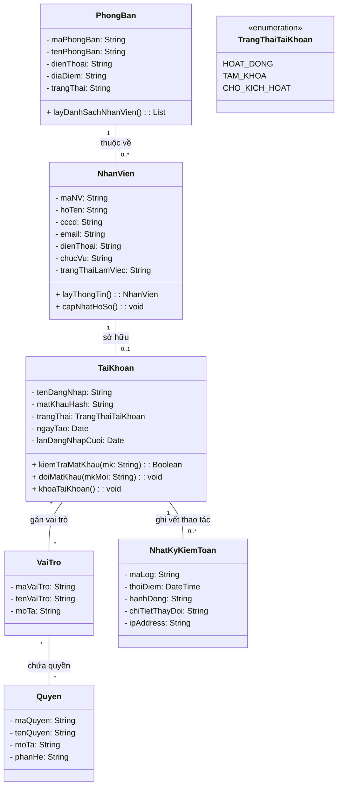
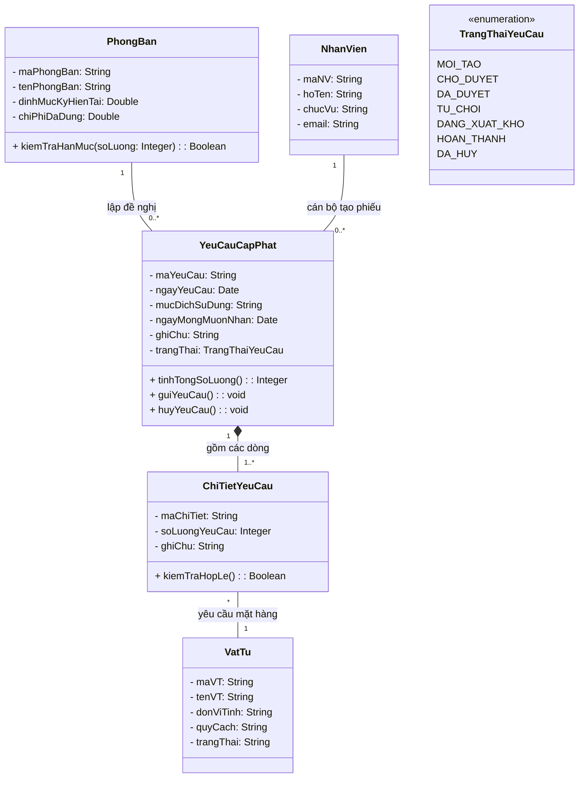
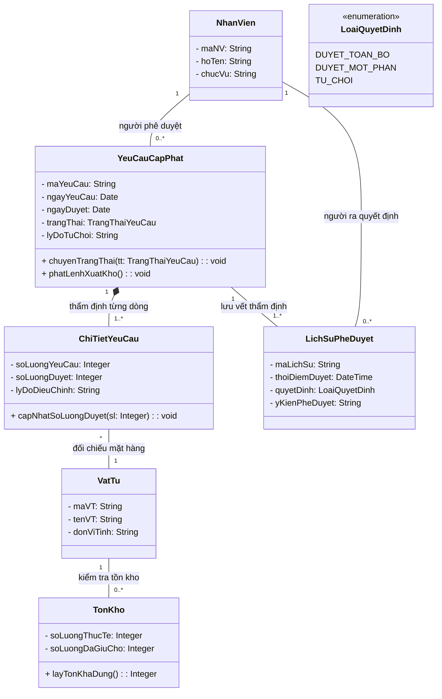
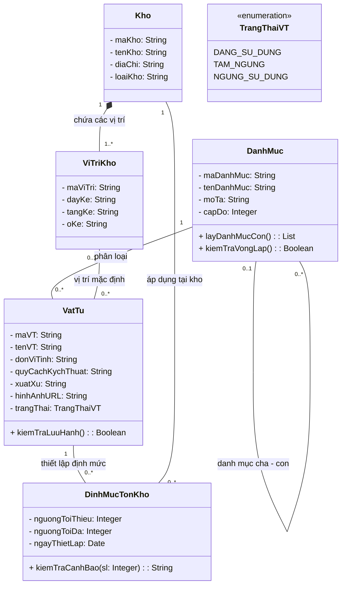
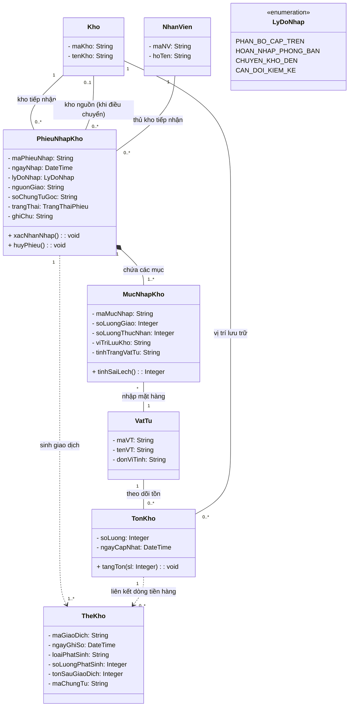
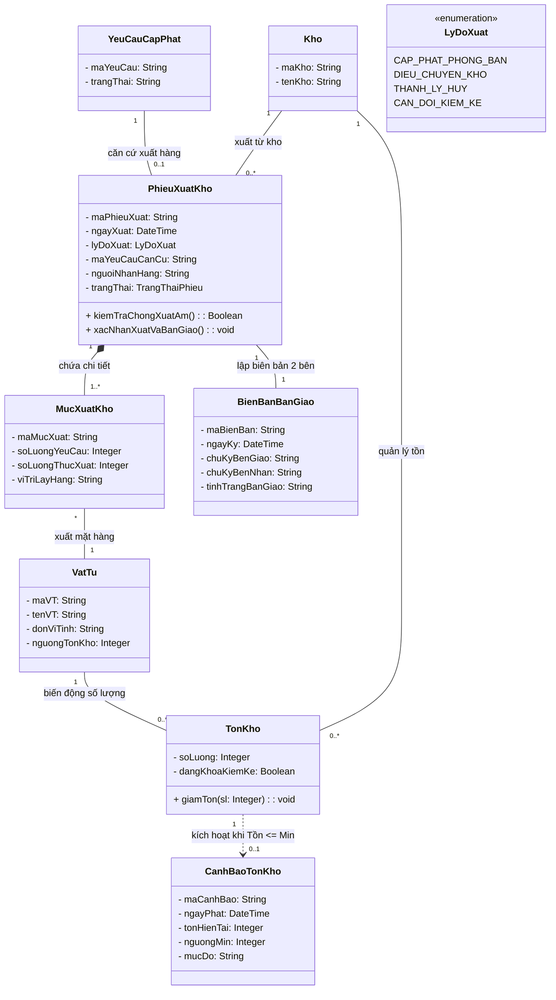
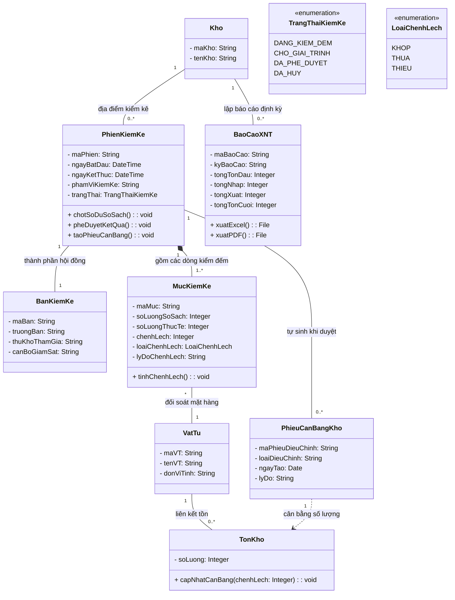

# BỘ 07 BIỂU ĐỒ LỚP MÔ HÌNH LĨNH VỰC (DOMAIN CLASS DIAGRAMS)
## Phiên bản đầu tiên theo 07 Ca sử dụng phân công cho 07 Thành viên

> **Học phần**: IT3120 - Phân tích và Thiết kế Hệ thống Thông tin  
> **Viện Công nghệ Thông tin và Truyền thông - Đại học Bách Khoa Hà Nội (HUST)**  
> **Đề tài**: Hệ thống Quản lý Vật tư và Kho hàng Nội bộ Tổ chức (Nhóm 8 - G8)  
> **Quy chuẩn OOSAD**: Ở giai đoạn phân tích ban đầu, mỗi thành viên xây dựng **01 Sơ đồ lớp lĩnh vực cục bộ (Local Domain Class Diagram)** tập trung vào các thực thể nghiệp vụ, thuộc tính và mối quan hệ trực tiếp trong phạm vi Ca sử dụng (Use Case) mà mình được phân công làm Chủ trì (Owner).

---

## 1. THÀNH VIÊN 1: VŨ HÒA BÌNH
### Sơ đồ lớp lĩnh vực: `UC01: Quản trị Người dùng & Phân quyền RBAC`

#### a. Giới thiệu phạm vi nghiệp vụ
Ca sử dụng `UC01` quản lý cấu trúc tổ chức phòng ban, hồ sơ nhân sự, tài khoản hệ thống và ma trận phân quyền dựa trên vai trò (Role-Based Access Control - RBAC). Sơ đồ lớp mô hình hóa mối quan hệ giữa Nhân viên, Phòng ban, Tài khoản, Vai trò, Quyền hạn và Nhật ký kiểm toán an toàn.

#### b. Biểu đồ lớp (Mermaid Class Diagram)

#### c. Giải thích các lớp & Quan hệ cốt lõi
- `NhanVien 1 -- 0..1 TaiKhoan`: Một nhân viên có tối đa một tài khoản đăng nhập (có nhân sự chưa được cấp tài khoản).
- `TaiKhoan * -- * VaiTro`: Ánh xạ nhiều - nhiều (mô hình RBAC). Một tài khoản có thể đảm nhận nhiều vai trò (ví dụ: vừa là `Quản lý kho`, vừa có vai trò `Admin`).
- `VaiTro * -- * Quyen`: Mỗi vai trò bao gồm tập hợp các quyền chức năng cụ thể (`XEM_KHO`, `DUYET_CAP_PHAT`, `NHAP_KHO`...).
- `NhatKyKiemToan`: Ghi vết mọi thao tác cấp/khóa tài khoản, đổi quyền để phục vụ hậu kiểm bảo mật.

---

## 2. THÀNH VIÊN 2: LÝ CÔNG HIẾU
### Sơ đồ lớp lĩnh vực: `UC03: Lập & Theo dõi Yêu cầu Cấp phát Vật tư`

#### a. Giới thiệu phạm vi nghiệp vụ
Ca sử dụng `UC03` mô hình hóa quy trình Đại diện phòng ban tạo lập phiếu đề nghị cấp phát vật tư/thiết bị theo nhu cầu công tác, đối chiếu định mức sử dụng kỳ của phòng ban và theo dõi tiến độ xử lý của phiếu.

#### b. Biểu đồ lớp (Mermaid Class Diagram)

#### c. Giải thích các lớp & Quan hệ cốt lõi
- `YeuCauCapPhat 1 *-- 1..* ChiTietYeuCau` (Composition - Hợp thành mạnh): Phiếu yêu cầu bắt buộc phải có ít nhất 1 dòng mặt hàng. Nếu phiếu yêu cầu bị xóa, các dòng chi tiết sẽ bị xóa theo.
- `PhongBan 1 -- 0..* YeuCauCapPhat`: Phiếu yêu cầu luôn gắn liền với một phòng ban để kiểm soát hạn mức chi tiêu/cấp phát trong kỳ.
- `ChiTietYeuCau * -- 1 VatTu`: Mỗi dòng chi tiết tham chiếu đến một loại vật tư lưu hành trong danh mục.

---

## 3. THÀNH VIÊN 3: PHẠM DUY HIẾU
### Sơ đồ lớp lĩnh vực: `UC04: Thẩm định & Phê duyệt Yêu cầu Cấp phát`

#### a. Giới thiệu phạm vi nghiệp vụ
Ca sử dụng `UC04` mô hình hóa tiến trình Quản lý kho tiếp nhận hàng đợi phiếu chờ duyệt, đối soát tồn kho khả dụng và hạn mức phòng ban, ra quyết định Duyệt toàn bộ, Duyệt một phần hoặc Từ chối, lưu vết lịch sử duyệt và kích hoạt thông báo tự động.

#### b. Biểu đồ lớp (Mermaid Class Diagram)

#### c. Giải thích các lớp & Quan hệ cốt lõi
- `TonKho` với phương thức `layTonKhaDung()`: Phản ánh nghiệp vụ cốt lõi của việc **Thẩm định**: $\text{Tồn khả dụng} = \text{Số lượng thực tế} - \text{Số lượng đã giữ chỗ}$.
- `ChiTietYeuCau.soLuongDuyet`: Cho phép Quản lý kho duyệt số lượng nhỏ hơn hoặc bằng số lượng yêu cầu (`soLuongDuyet <= soLuongYeuCau`) phục vụ nghiệp vụ **Duyệt một phần**.
- `LichSuPheDuyet`: Lưu vết vĩnh viễn ai là người duyệt, thời điểm nào, duyệt bao nhiêu để làm căn cứ minh bạch trong kiểm toán tài sản.

---

## 4. THÀNH VIÊN 4: NGUYỄN TRUNG NGÂN
### Sơ đồ lớp lĩnh vực: `UC02: Quản lý Danh mục & Hồ sơ Vật tư, Thiết bị`

#### a. Giới thiệu phạm vi nghiệp vụ
Ca sử dụng `UC02` chịu trách nhiệm mô hình hóa cấu trúc phân loại hình cây của danh mục vật tư, hồ sơ thông số kỹ thuật, quy cách đóng gói, đơn vị tính và định mức tồn an toàn tối thiểu/tối đa tại từng kho.

#### b. Biểu đồ lớp (Mermaid Class Diagram)

#### c. Giải thích các lớp & Quan hệ cốt lõi
- `DanhMuc 0..1 -- 0..* DanhMuc` (Reflexive Association - Tự quy chiếu): Thể hiện cây danh mục nhiều cấp (ví dụ: *Vật tư văn phòng $\rightarrow$ Giấy in $\rightarrow$ Giấy A4*).
- `DinhMucTonKho` (Lớp liên kết giữa `VatTu` và `Kho`): Mỗi vật tư tại mỗi kho khác nhau có thể có ngưỡng an toàn khác nhau (ví dụ: Kho trung tâm cần dự trữ tối thiểu 50 ram giấy, nhưng kho chi nhánh chỉ cần 5 ram).
- `Kho 1 *-- 1..* ViTriKho`: Quản lý kho chi tiết đến từng Dãy Kệ - Tầng - Ô để phục vụ công tác định vị khi nhập và lấy hàng.

---

## 5. THÀNH VIÊN 5: HOÀNG TRỌNG ĐỨC ANH
### Sơ đồ lớp lĩnh vực: `UC05: Quản lý Nhập kho & Điều chuyển Vật tư`

#### a. Giới thiệu phạm vi nghiệp vụ
Ca sử dụng `UC05` mô hình hóa nghiệp vụ tiếp nhận nguồn vật tư phân bổ từ cấp trên, thu hồi hoàn nhập từ phòng ban và điều chuyển giữa các kho nội bộ; thực hiện kiểm đếm thực nhận, tăng tồn kho nguyên tử và ghi nhận lịch sử Thẻ kho (Stock Card).

#### b. Biểu đồ lớp (Mermaid Class Diagram)

#### c. Giải thích các lớp & Quan hệ cốt lõi
- `PhieuNhapKho 1 *-- 1..* MucNhapKho`: Quan hệ hợp thành, ghi nhận từng dòng thực nhận kèm vị trí kệ cất hàng và tình trạng vật tư.
- `Kho (Kho nhận) & Kho (Kho nguồn)`: Khi là nhập điều chuyển kho, phiếu nhập liên kết cả 2 kho để đối soát khớp số lượng xuất đi và nhập đến.
- `TheKho (Stock Card)`: Thực thể kế toán ghi nhận sự kiện tăng tồn kho nguyên tử (`soLuongPhatSinh = +soLuongThucNhan`), đảm bảo tính toàn vẹn số liệu và khả năng truy vết lịch sử giao dịch.

---

## 6. THÀNH VIÊN 6: ĐỖ DUY ĐỨC
### Sơ đồ lớp lĩnh vực: `UC06: Quản lý Xuất kho & Bàn giao Cấp phát`

#### a. Giới thiệu phạm vi nghiệp vụ
Ca sử dụng `UC06` mô hình hóa quy trình Thủ kho lập phiếu xuất căn cứ theo phiếu yêu cầu đã duyệt, kiểm tra chống xuất âm và khóa kiểm kê, in phiếu xuất, bàn giao hiện vật cho cán bộ phòng ban, ký nhận biên bản, trừ tồn kho và kích hoạt cảnh báo tồn an toàn.

#### b. Biểu đồ lớp (Mermaid Class Diagram)

#### c. Giải thích các lớp & Quan hệ cốt lõi
- `YeuCauCapPhat 1 -- 0..1 PhieuXuatKho`: Ràng buộc nghiệp vụ bắt buộc: một phiếu xuất cấp phát chỉ được tạo khi có phiếu yêu cầu đã duyệt (`DA_DUYET`).
- `TonKho.dangKhoaKiemKe`: Thuộc tính bảo vệ ngăn chặn xuất kho nếu mặt hàng đang nằm trong đợt kiểm kê chưa chốt sổ.
- `BienBanBanGiao`: Minh chứng pháp lý giao nhận giữa Thủ kho và Đại diện phòng ban.
- `CanhBaoTonKho`: Tự động sinh ra khi việc trừ tồn kho khiến `TonKho.soLuong <= VatTu.nguongTonKho`.

---

## 7. THÀNH VIÊN 7: [ĐIỀN HỌ VÀ TÊN]
### Sơ đồ lớp lĩnh vực: `UC07: Kiểm kê Kho hàng & Báo cáo Thống kê`

#### a. Giới thiệu phạm vi nghiệp vụ
Ca sử dụng `UC07` mô hình hóa quy trình tổ chức phiên kiểm kê hiện vật định kỳ/đột xuất, chốt số dư sổ sách tại thời điểm kiểm kê (Stock Snapshot), ghi nhận số kiểm đếm thực tế, tính toán chênh lệch thừa/thiếu, tự sinh phiếu cân bằng kho và kết xuất báo cáo thống kê Xuất - Nhập - Tồn (XNT).

#### b. Biểu đồ lớp (Mermaid Class Diagram)

#### c. Giải thích các lớp & Quan hệ cốt lõi
- `PhienKiemKe 1 *-- 1..* MucKiemKe`: Lưu lại ảnh chụp chốt tồn sổ sách (`soLuongSoSach`) và đối chiếu với số thực tế nhân viên kiểm đếm tại kệ (`soLuongThucTe`).
- `MucKiemKe.chenhLech`: $\text{chenhLech} = \text{soLuongThucTe} - \text{soLuongSoSach}$. Tự động phân loại: `KHOP`, `THUA`, `THIEU`.
- `PhieuCanBangKho`: Khi kiểm kê được duyệt, lớp này phát sinh giao dịch nhập cân đối (nếu thừa) hoặc xuất cân đối (nếu thiếu) để đưa `TonKho.soLuong` về đúng với thực tế.
- `BaoCaoXNT`: Thực thể tổng hợp báo cáo kỳ theo công thức cân đối kế toán: $\text{Tồn cuối} = \text{Tồn đầu} + \text{Tổng nhập} - \text{Tổng xuất}$.

---

## BẢNG TỔNG KẾT PHÂN CÔNG 07 SƠ ĐỒ LỚP CHO 07 THÀNH VIÊN

| STT | Thành viên | Ca sử dụng chủ trì (Owner) | Các lớp chính trong sơ đồ lớp cục bộ | Mẫu phân tích áp dụng |
|:---:|:---|:---|:---|:---|
| **01** | **Vũ Hòa Bình** | **UC01**: Quản trị Người dùng & Phân quyền RBAC | `PhongBan`, `NhanVien`, `TaiKhoan`, `VaiTro`, `Quyen`, `NhatKyKiemToan` | RBAC Matrix & Party Pattern |
| **02** | **Lý Công Hiếu** | **UC03**: Lập & Theo dõi Yêu cầu Cấp phát | `PhongBan`, `NhanVien`, `YeuCauCapPhat`, `ChiTietYeuCau`, `VatTu` | Header - Line Item Pattern |
| **03** | **Phạm Duy Hiếu** | **UC04**: Thẩm định & Phê duyệt Yêu cầu | `YeuCauCapPhat`, `ChiTietYeuCau`, `TonKho`, `VatTu`, `LichSuPheDuyet` | Approval Workflow Pattern |
| **04** | **Nguyễn Trung Ngân**| **UC02**: Quản lý Danh mục & Hồ sơ Vật tư | `DanhMuc`, `VatTu`, `Kho`, `ViTriKho`, `DinhMucTonKho` | Catalog - Item & Tree Pattern |
| **05** | **Hoàng Trọng Đức Anh**| **UC05**: Quản lý Nhập kho & Điều chuyển | `PhieuNhapKho`, `MucNhapKho`, `Kho`, `TonKho`, `TheKho`, `VatTu` | Transaction & Stock Movement |
| **06** | **Đỗ Duy Đức** | **UC06**: Quản lý Xuất kho & Bàn giao | `YeuCauCapPhat`, `PhieuXuatKho`, `MucXuatKho`, `TonKho`, `BienBanBanGiao`, `CanhBaoTonKho` | Transaction & Handover Pattern |
| **07** | **Thành viên 7** | **UC07**: Kiểm kê Kho hàng & Báo cáo | `PhienKiemKe`, `BanKiemKe`, `MucKiemKe`, `TonKho`, `PhieuCanBangKho`, `BaoCaoXNT` | Stock Audit & Balance Pattern |

---
*Tài liệu này là phiên bản đầu tiên của Mô hình Lĩnh vực (Domain Model) phục vụ việc phân công đồng đều 1 thành viên = 1 sơ đồ lớp ca sử dụng cho Nhóm 8 (IT3120 - HUST).*
