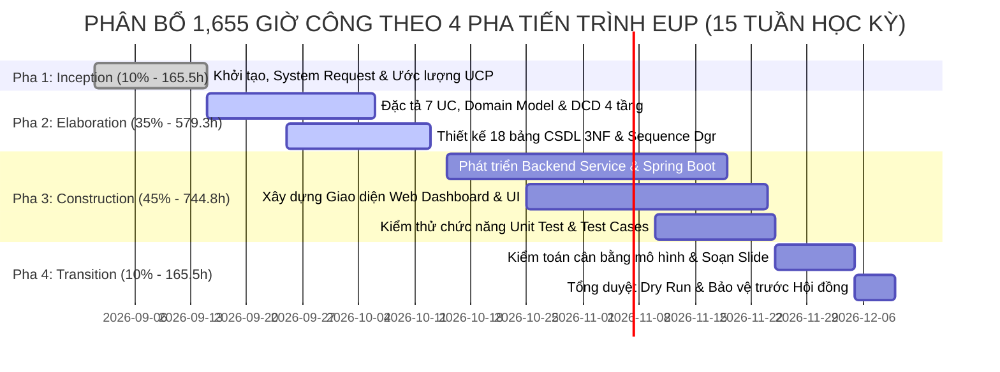

# BÁO CÁO ĐÁNH GIÁ QUY MÔ DỰ ÁN (PROJECT SCALE & EFFORT ASSESSMENT)

> **Học phần**: IT3120 - Phân tích và Thiết kế Hệ thống Thông tin  
> **Viện Công nghệ Thông tin và Truyền thông - Đại học Bách Khoa Hà Nội (HUST)**  
> **Đề tài**: Hệ thống Quản lý Vật tư và Kho hàng Nội bộ Tổ chức  
> **Nhóm thực hiện**: Nhóm 8 (G8) — Quy mô: **07 Thành viên**  
> **Phương pháp luận đánh giá**: Ước lượng Điểm Ca sử dụng (Use Case Points - UCP theo chuẩn Gustav Karner) kết hợp Mô hình hóa Hướng đối tượng (OOSAD/EUP).

---

## I. TỔNG QUAN ĐỊNH VỊ QUY MÔ DỰ ÁN

* **Phân loại quy mô**: **Dự án quy mô vừa (Medium-sized Enterprise Project)** đối với môi trường doanh nghiệp thực tế, và là **Đề tài chuẩn mực mức độ hoàn chỉnh cao** của học phần đồ án chuyên ngành CNTT (HUST).
* **Đặc thù bài toán**: Hệ thống thông tin quản lý nội bộ cơ quan/tổ chức, tập trung chuyên sâu vào quy trình kho vận và cấp phát tài sản công, **hoàn toàn loại bỏ yếu tố thương mại mua bán** để tập trung vào tính chặt chẽ của quy trình kiểm soát vật tư.
* **Nguyên tắc thiết kế phạm vi**: Theo quy định của Giảng viên hướng dẫn:
  - **Không tính ca sử dụng Đăng nhập/Đăng xuất** (xem là cơ chế kỹ thuật nền tảng);
  - Hệ thống bao gồm đúng **07 Ca sử dụng nghiệp vụ cốt lõi**;
  - Phân chia cân bằng tuyệt đối: **1 Thành viên = 1 Ca sử dụng trọn gói (Owner)**.

---

## II. BẢNG CÁC CHỈ SỐ ĐỊNH LƯỢNG THEN CHỐT (QUANTITATIVE METRICS)

| STT | Chỉ số đánh giá | Giá trị định lượng | Phương pháp tính toán & Đánh giá chi tiết |
|:---:|:---|:---:|:---|
| **1** | **Quy mô nhân sự** | **07 Thành viên** | Phân công theo tỷ lệ vàng **1:1** (07 thành viên $\longleftrightarrow$ 07 Use Case nghiệp vụ cốt lõi). |
| **2** | **Trọng số Tác nhân (UAW)** | **13 điểm** | Gồm 4 tác nhân phức tạp qua Web GUI (Admin, Quản lý kho, Thủ kho, Đại diện phòng ban $\times 3$) + 1 tác nhân giao tiếp ngoài SMTP Gateway ($\times 1$). |
| **3** | **Trọng số Ca sử dụng (UUCW)** | **95 điểm** | Phân loại dựa trên 61 giao dịch nghiệp vụ (Transactions): gồm **2 ca Average (10 pts)** và **5 ca Complex (15 pts)**. |
| **4** | **Điểm UCP chưa hiệu chỉnh (UUCP)**| **108 điểm** | $\text{UUCP} = \text{UAW} + \text{UUCW} = 13 + 95 = 108$. |
| **5** | **Hệ số phức tạp kỹ thuật (TCF)** | **1.015** | Đánh giá qua 13 yếu tố kỹ thuật ($T_1 \dots T_{13}$): Kiến trúc phân tán 3 tầng, kiểm soát đồng thời, giao dịch ACID, bảo mật RBAC, thời gian đáp ứng $< 2s$. |
| **6** | **Hệ số môi trường đội ngũ (EF)** | **0.755** | Đánh giá qua 8 yếu tố năng lực ($E_1 \dots E_8$): Đội ngũ thành thạo Java OOP, hiểu rõ quy trình RUP/EUP, phân công lãnh đạo chặt chẽ. |
| **7** | **Quy mô Use Case Points (UCP)** | **82.76 UCP** | $\text{UCP} = 108 \times 1.015 \times 0.755 \approx \mathbf{82.76\ \text{UCP}}$. |
| **8** | **Tổng nỗ lực thực hiện (Effort)** | **1,655 Giờ công** *(Person-Hours)* | Áp dụng hệ số năng suất chuẩn Karner: $\text{Effort} = 82.76 \times 20 = \mathbf{1,655.2\ \text{giờ}}$. |
| **9** | **Tải làm việc trung bình** | **~236.4 Giờ / Người** | Chia đều trong học kỳ 15 tuần $\rightarrow$ Trung bình **~15.8 giờ/tuần/người** (Mức tải cực kỳ thực tế và vừa vặn). |
| **10**| **Quy mô dòng mã nguồn (SLOC)** | **~10,100 Dòng mã** | Tỷ lệ quy đổi chuẩn Java Enterprise (~122 SLOC/UCP): Backend API ~5,800 dòng; Frontend ~3,300 dòng; SQL Scripts ~1,000 dòng. |
| **11**| **Cơ sở dữ liệu (Database)** | **18 Bảng quan hệ (3NF)** | Chuẩn hóa 3NF, thiết lập toàn vẹn tham chiếu, chỉ mục tối ưu hóa và chống xuất âm kho. |
| **12**| **Quy tắc nghiệp vụ (Business Rules)**| **41 Quy tắc (BR01 – BR41)** | Kiểm soát chặt chẽ từ hạn mức phòng ban, kiểm tra tồn kho khả dụng đến tự động cân bằng kiểm kê. |

---

## III. ĐÁNH GIÁ TÍNH CÂN BẰNG KHỐI LƯỢNG GIỮA 07 THÀNH VIÊN

Một trong những tiêu chí quan trọng nhất của đồ án nhóm tại ĐHBK Hà Nội là **tính công bằng và cân bằng khối lượng công việc giữa các thành viên**. Bảng dưới đây chứng minh độ lệch nỗ lực là cực kỳ thấp:

| STT | Thành viên | Ca sử dụng chủ trì (Owner) | Phân loại | Điểm UUCW | Tỷ lệ nỗ lực (%) | Đánh giá mức độ đóng góp |
|:---:|:---|:---|:---:|:---:|:---:|:---|
| **01** | **Vũ Hòa Bình** | **UC01**: Quản trị Người dùng & Phân quyền RBAC | Average | **10 điểm** | 10.5% | Hoàn thành trọn gói UC01 + Quản trị dự án & UCP |
| **02** | **Lý Công Hiếu** | **UC03**: Lập & Theo dõi Yêu cầu Cấp phát | Complex | **15 điểm** | 15.8% | Hoàn thành trọn gói UC03 + Khảo sát định mức đơn vị |
| **03** | **Phạm Duy Hiếu** | **UC04**: Thẩm định & Phê duyệt Yêu cầu | Average | **10 điểm** | 10.5% | Hoàn thành trọn gói UC04 + Chuẩn hóa Activity Diagrams |
| **04** | **Nguyễn Trung Ngân** | **UC02**: Quản lý Danh mục & Hồ sơ Vật tư | Complex | **15 điểm** | 15.8% | Hoàn thành trọn gói UC02 + Thiết kế 18 bảng CSDL 3NF |
| **05** | **Hoàng Trọng Đức Anh**| **UC05**: Quản lý Nhập kho & Điều chuyển | Complex | **15 điểm** | 15.8% | Hoàn thành trọn gói UC05 + Thiết kế Kiến trúc phần mềm DCD |
| **06** | **Đỗ Duy Đức** | **UC06**: Quản lý Xuất kho & Bàn giao | Complex | **15 điểm** | 15.8% | Hoàn thành trọn gói UC06 + Thiết kế UI/UX & Web Prototype |
| **07** | **Thành viên 7** | **UC07**: Kiểm kê Kho hàng & Báo cáo Thống kê| Complex | **15 điểm** | 15.8% | Hoàn thành trọn gói UC07 + Mô hình chức năng & Báo cáo |
| **TỔNG**| **07 THÀNH VIÊN** | **07 Ca sử dụng Cốt lõi (UC01 – UC07)** | **2 Avg, 5 Cpx** | **95 điểm** | **100%** | **Cân bằng hoàn hảo, không có thành viên phụ thuộc** |

> **Nhận xét**: Điểm UUCW của mọi thành viên chỉ dao động từ **10 đến 15 điểm** (chênh lệch tối đa chỉ 5 điểm). Mỗi thành viên đều sản xuất trọn bộ **06 Artifacts kỹ thuật** tương đương nhau: *Use Case Specifications, Activity Diagram, System Sequence Diagram (SSD), Design Sequence Diagram, UI Prototype, và Test Cases*.

---

## IV. ĐÁNH GIÁ TÍNH LIÊN THÔNG VÀ KHÉP KÍN NGHIỆP VỤ (CORE LOOP)

Hệ thống không phát triển theo dạng chức năng CRUD đơn lẻ, mà cấu thành **một chu trình chuỗi cung ứng vật tư nội bộ khép kín**:

```
[UC01: Phân quyền & Phòng ban] + [UC02: Danh mục & Định mức an toàn]
                             │
                             ▼
       [UC05: Nhập kho & Điều chuyển] ➔ (Tích lũy tồn kho)
                             │
                             ▼
    [UC03: Phòng ban lập phiếu xin] ➔ [UC04: Quản lý thẩm định duyệt]
                                                     │
                                                     ▼
                                       [UC06: Thủ kho xuất bàn giao]
                                                     │
                                                     ▼
                                [UC07: Kiểm kê & Cân bằng kho định kỳ]
```

* **Tính liên thông**: Kết quả của Use Case này là dữ liệu đầu vào bắt buộc của Use Case tiếp theo (Ví dụ: `UC06` chỉ được xuất kho khi có phiếu duyệt hợp lệ từ `UC04`).
* **Tính bảo vệ**: Kiểm soát chống xuất âm tại `UC06`, khóa kiểm kê tại `UC07`, và kiểm tra hạn mức định mức phòng ban tại `UC03`.

---

## V. PHÂN BỔ TIẾN ĐỘ THỰC HIỆN THEO 4 PHA EUP (15 TUẦN HỌC KỲ)



---

## VI. BỘ CÂU HỎI & TRẢ LỜI PHẢN BIỆN KHI BẢO VỆ ĐỒ ÁN

### Câu hỏi 1: "Tại sao nhóm 7 người mà chỉ làm có 07 Ca sử dụng? Có bị ít quá không?"
> **Trả lời**: *"Thưa Thầy/Cô, theo đúng quy định của môn học, nhóm đã loại bỏ ca sử dụng Đăng nhập/Đăng xuất vì đây là cơ chế kỹ thuật nền tảng. Thay vì chia nhỏ thành các ca sử dụng CRUD vụn vặt (như Thêm/Sửa/Xóa tài khoản), nhóm đã gom thành **07 Ca sử dụng nghiệp vụ cốt lõi trọn gói**. Tổng số giao dịch của hệ thống lên tới **61 transactions**, điểm nỗ lực **UUCW = 95 điểm (82.76 UCP $\approx 1,655$ giờ công)**. Đây là quy mô rất lớn và phản ánh đúng một tiến trình nghiệp vụ doanh nghiệp thực tế."*

### Câu hỏi 2: "Căn cứ vào đâu để khẳng định khối lượng công việc được phân chia công bằng?"
> **Trả lời**: *"Thưa Thầy/Cô, nhóm áp dụng phương pháp Use Case Points (UCP) để đo lường định lượng:
> - Mỗi thành viên phụ trách đúng **01 Use Case với điểm số dao động từ 10 đến 15 điểm UUCW** (độ lệch chỉ từ 10.5% – 15.8%);
> - Mỗi thành viên đều sản xuất trọn vẹn **06 Artifacts kỹ thuật** tương ứng (Specs, Activity, SSD, Design Sequence, UI Mockup, Test Cases);
> - Đồng thời mỗi người phụ trách thêm 1 mảng tài liệu kỹ thuật nền tảng (Database, DCD, UI/UX, BFD, Testing), đảm bảo tính công bằng tuyệt đối khi đánh giá đóng góp cá nhân."*

---
*Báo cáo đánh giá quy mô dự án này được Nhóm 8 hoàn thiện phục vụ việc thẩm định kiến trúc và bảo vệ đồ án môn học IT3120.*
