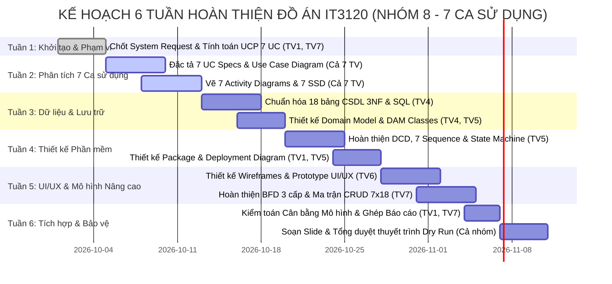

# KẾ HOẠCH PHÂN CÔNG NHIỆM VỤ DỰ ÁN (07 THÀNH VIÊN — 07 CA SỬ DỤNG CỐT LÕI)

> **Học phần**: IT3120 - Phân tích và Thiết kế Hệ thống Thông tin  
> **Viện Công nghệ Thông tin và Truyền thông - Đại học Bách Khoa Hà Nội (HUST)**  
> **Đề tài**: Hệ thống Quản lý Vật tư và Kho hàng Nội bộ Tổ chức  
> **Nhóm thực hiện**: Nhóm 8 (G8) — Quy mô: **07 Thành viên**  
> **Phương pháp luận**: Phân tích & Thiết kế Hướng đối tượng (OOSAD) theo tiến trình EUP & UML 2.5  
> **Quy định của Giảng viên**: **Không tính ca sử dụng Đăng nhập/Đăng xuất**; Giới hạn tối đa **07 Ca sử dụng nghiệp vụ cốt lõi**; Phân chia cân bằng **1 Thành viên = 1 Ca sử dụng trọn gói (Owner)**.  
> **Khối lượng dự án**: 82.76 UCP $\approx$ **1,655 giờ làm việc** (Trung bình ~236.4 giờ/thành viên $\approx$ 15.8 giờ/tuần/người trong học kỳ 15 tuần).

---

## I. DANH SÁCH THÀNH VIÊN, VAI TRÒ CHUYÊN MÔN & CA SỬ DỤNG CHỦ TRÌ

| STT | Họ và Tên | MSSV | Vai trò chính trong dự án | Ca sử dụng chủ trì trọn gói (Owner) | Phân loại & Điểm UUCW |
|:---:|:---|:---:|:---|:---|:---:|
| **01** | **Vũ Hòa Bình** | 2021xxxx *(Cập nhật)* | **Project Manager & Lead Architect**<br>(Trưởng nhóm & Kiến trúc sư trưởng) | **UC01**: Quản trị Người dùng & Phân quyền RBAC | Average (10 pts) |
| **02** | **Lý Công Hiếu** | 2021xxxx *(Cập nhật)* | **Business Analyst 1**<br>(Phân tích Cấp phát & Đơn vị) | **UC03**: Lập & Theo dõi Yêu cầu Cấp phát Vật tư | Complex (15 pts) |
| **03** | **Phạm Duy Hiếu** | 2021xxxx *(Cập nhật)* | **Business Analyst 2**<br>(Phân tích Thẩm định & Phê duyệt) | **UC04**: Thẩm định & Phê duyệt Yêu cầu Cấp phát | Average (10 pts) |
| **04** | **Nguyễn Trung Ngân** | 2021xxxx *(Cập nhật)* | **Database Architect & Data Engineer**<br>(Kiến trúc sư Cơ sở dữ liệu) | **UC02**: Quản lý Danh mục & Hồ sơ Vật tư, Thiết bị | Complex (15 pts) |
| **05** | **Hoàng Trọng Đức Anh** | 2021xxxx *(Cập nhật)* | **Software System Architect**<br>(Kiến trúc sư Thiết kế Phần mềm) | **UC05**: Quản lý Nhập kho & Điều chuyển Vật tư | Complex (15 pts) |
| **06** | **Đỗ Duy Đức** | 2021xxxx *(Cập nhật)* | **UI/UX Designer & Prototype Specialist**<br>(Thiết kế Giao diện & Bản mẫu) | **UC06**: Quản lý Xuất kho & Bàn giao Cấp phát | Complex (15 pts) |
| **07** | **Thành viên 7**<br>*(Điền Họ tên)* | 2021xxxx *(Cập nhật)* | **QA Lead & Functional Auditor**<br>(Trưởng nhóm Đảm bảo Chất lượng & Thuyết trình) | **UC07**: Kiểm kê Kho hàng & Báo cáo Thống kê | Complex (15 pts) |

---

## II. MA TRẬN PHÂN CÔNG CÔNG VIỆC CHI TIẾT (WORK BREAKDOWN STRUCTURE - WBS)

> **Quy ước vai trò**:
> - **R (Responsible - Phụ trách chính)**: Chịu trách nhiệm trực tiếp sản xuất, viết tài liệu, dựng mã PlantUML và bàn giao deliverable.
> - **S (Support / Review - Phối hợp & Kiểm tra)**: Hỗ trợ cung cấp dữ liệu đầu vào, review chéo và đảm bảo tính nhất quán giữa các mô hình.

### 1. Phân công theo 18 Hồ sơ Tài liệu & Deliverables

| STT | Mã Hồ sơ / Deliverable | Tên Hạng mục Công việc | Phụ trách chính (R) | Phối hợp / Review (S) | Khối lượng ước tính | Sản phẩm bàn giao cụ thể |
|:---:|:---|:---|:---:|:---:|:---:|:---|
| 01 | **Doc 01** | System Request (Yêu cầu hệ thống) | **Vũ Hòa Bình** | Lý Công Hiếu | ~100h | [01-system-request.md](./docs/01-system-request.md) |
| 02 | **Doc 02** | Use Case Diagram (Biểu đồ 7 ca sử dụng) | **Lý Công Hiếu** | Phạm Duy Hiếu | ~120h | [02-use-case-diagram.md](./docs/02-use-case-diagram.md), [use-case-diagram.puml](./plantuml/use-case-diagram.puml) |
| 03 | **Doc 03** | Use Case Specs (Đặc tả chi tiết 7 UC) | **Cả 7 thành viên** *(Mỗi TV 1 UC của mình)* | Vũ Hòa Bình (Tổng hợp) | ~250h | [03-use-case-specs.md](./docs/03-use-case-specs.md) |
| 04 | **Doc 04** | Activity Diagrams (Sơ đồ hoạt động) | **Cả 7 thành viên** *(Mỗi TV vẽ Activity cho UC)* | Phạm Duy Hiếu (Review) | ~150h | [04-activity-diagrams.md](./docs/04-activity-diagrams.md), [activity-diagrams.puml](./plantuml/activity-diagrams.puml) |
| 05 | **Doc 05** | Domain Class Diagram (Biểu đồ lớp lĩnh vực) | **Nguyễn Trung Ngân** | Hoàng Trọng Đức Anh | ~140h | [05-domain-class-diagram.md](./docs/05-domain-class-diagram.md), [domain-class-diagram.puml](./plantuml/domain-class-diagram.puml) |
| 06 | **Doc 06** | Object Diagrams (Biểu đồ đối tượng) | **Nguyễn Trung Ngân** | Phạm Duy Hiếu | ~80h | [06-object-diagrams.md](./docs/06-object-diagrams.md), [object-diagrams.puml](./plantuml/object-diagrams.puml) |
| 07 | **Doc 07** | SSD (Sơ đồ tuần tự mức hệ thống) | **Cả 7 thành viên** *(Mỗi TV dựng SSD cho UC)* | Lý Công Hiếu (Review) | ~140h | [07-ssd.md](./docs/07-ssd.md), [ssd.puml](./plantuml/ssd.puml) |
| 08 | **Doc 08** | Design Sequence Diagrams (Tuần tự thiết kế) | **Cả 7 thành viên** *(Mỗi TV dựng Sequence cho UC)* | Hoàng Trọng Đức Anh (Review)| ~200h | [08-sequence-diagrams.md](./docs/08-sequence-diagrams.md), [sequence-diagrams.puml](./plantuml/sequence-diagrams.puml) |
| 09 | **Doc 09** | State Machine Diagrams (Máy trạng thái) | **Hoàng Trọng Đức Anh** | Lý Công Hiếu | ~100h | [09-state-machine.md](./docs/09-state-machine.md), [state-machine.puml](./plantuml/state-machine.puml) |
| 10 | **Doc 10** | Package Diagram (Sơ đồ gói kiến trúc) | **Hoàng Trọng Đức Anh** | Vũ Hòa Bình | ~70h | [10-package-diagram.md](./docs/10-package-diagram.md), [package-diagram.puml](./plantuml/package-diagram.puml) |
| 11 | **Doc 11** | Deployment Diagram (Sơ đồ triển khai) | **Hoàng Trọng Đức Anh** | Vũ Hòa Bình | ~70h | [11-deployment-diagram.md](./docs/11-deployment-diagram.md), [deployment-diagram.puml](./plantuml/deployment-diagram.puml) |
| 12 | **Doc 12** | Design Class Diagram (Biểu đồ lớp thiết kế DCD) | **Hoàng Trọng Đức Anh** | Nguyễn Trung Ngân | ~220h | [12-design-class-diagram.md](./docs/12-design-class-diagram.md), [design-class-diagram.puml](./plantuml/design-class-diagram.puml) |
| 13 | **Doc 13** | Database Design (CSDL 18 bảng & DDL SQL) | **Nguyễn Trung Ngân** | Vũ Hòa Bình | ~200h | [13-database-design.md](./docs/13-database-design.md), [database-design.puml](./plantuml/database-design.puml), [schema.sql](./sql/schema.sql), [seed-data.sql](./sql/seed-data.sql) |
| 14 | **Doc 14** | DAM Classes (Lớp truy cập dữ liệu DAO) | **Nguyễn Trung Ngân** | Hoàng Trọng Đức Anh | ~120h | [14-dam-classes.md](./docs/14-dam-classes.md), [dam-classes.puml](./plantuml/dam-classes.puml) |
| 15 | **Doc 15** | UI/UX Design (Thiết kế giao diện & Wireframes) | **Đỗ Duy Đức** *(Chủ trì hệ thống UI)* | Cả nhóm (phối hợp) | ~180h | [15-ui-design.md](./docs/15-ui-design.md), Wireframes Dashboard & Phiếu xuất/nhập |
| 16 | **Doc 16** | UCP Estimation (Ước lượng chi phí 7 UC) | **Vũ Hòa Bình** | Thành viên 7 | ~80h | [16-ucp-estimation.md](./docs/16-ucp-estimation.md) (UAW=13, UUCW=95, 82.76 UCP) |
| 17 | **Doc 17** | Functional Model (Mô hình chức năng 7 UC) | **Thành viên 7** | Lý Công Hiếu | ~200h | [17-functional-model.md](./docs/17-functional-model.md), BFD 3 cấp, CRUD 7x18, 41 Business Rules |
| 18 | **Doc 18** | Presentation & Defense (Kịch bản bảo vệ 7 UC) | **Thành viên 7** | Vũ Hòa Bình | ~120h | [18-functional-model-presentation.md](./docs/18-functional-model-presentation.md), Bộ Slide PPTX & Kịch bản bảo vệ |

---

### 2. Bảng Phân chia Cân bằng 07 Ca sử dụng cho 07 Thành viên (1 Thành viên = 1 UC)

> **Nguyên tắc phân chia theo yêu cầu giảng viên hướng dẫn**:
> 1. **Cân bằng số lượng**: Đúng **07 thành viên $\longleftrightarrow$ Đúng 07 Ca sử dụng nghiệp vụ cốt lõi** (Tỷ lệ 1:1 hoàn hảo).
> 2. **Cân bằng nỗ lực (UUCW)**: Tổng trọng số ca sử dụng chưa hiệu chỉnh là **95 điểm**; phân bổ gồm **2 ca Average (10 điểm)** và **5 ca Complex (15 điểm)**. Độ lệch giữa mọi thành viên chỉ từ **10 đến 15 điểm** (cực kỳ đồng đều, không ai làm quá nhiều hay quá ít).
> 3. **Tính liên thông nghiệp vụ (Cohesion)**: Mỗi thành viên phụ trách một tiến trình nghiệp vụ trọn vẹn mang lại giá trị hoàn chỉnh cho tác nhân.

| STT | Thành viên | Vai trò chuyên môn | Ca sử dụng phụ trách chính (Owner) | Tác nhân chính | Phân loại | Điểm UUCW | Tỷ lệ nỗ lực |
|:---:|:---|:---|:---|:---|:---:|:---:|:---:|
| **01** | **Vũ Hòa Bình** | PM & Lead Architect | **UC01: Quản trị Người dùng & Phân quyền RBAC** | Quản trị viên (Admin) | Average (6 trans.) | **10 điểm** | 10.5% |
| **02** | **Lý Công Hiếu** | Lead BA 1 (Phòng ban & Yêu cầu) | **UC03: Lập & Theo dõi Yêu cầu Cấp phát Vật tư** | Đại diện Phòng ban | Complex (9 trans.) | **15 điểm** | 15.8% |
| **03** | **Phạm Duy Hiếu** | Lead BA 2 (Thẩm định & Phê duyệt) | **UC04: Thẩm định & Phê duyệt Yêu cầu Cấp phát** | Quản lý kho | Average (6 trans.) | **10 điểm** | 10.5% |
| **04** | **Nguyễn Trung Ngân** | Database Architect & Data Engineer | **UC02: Quản lý Danh mục & Hồ sơ Vật tư, Thiết bị**| Quản lý kho | Complex (8 trans.) | **15 điểm** | 15.8% |
| **05** | **Hoàng Trọng Đức Anh**| Software System Architect | **UC05: Quản lý Nhập kho & Điều chuyển Vật tư** | Thủ kho / NV Kho | Complex (10 trans.)| **15 điểm** | 15.8% |
| **06** | **Đỗ Duy Đức** | UI/UX Designer & Prototype | **UC06: Quản lý Xuất kho & Bàn giao Cấp phát** | Thủ kho / NV Kho | Complex (10 trans.)| **15 điểm** | 15.8% |
| **07** | **Thành viên 7** | QA Lead & Functional Auditor | **UC07: Kiểm kê Kho hàng & Báo cáo Thống kê** | Quản lý kho | Complex (12 trans.)| **15 điểm** | 15.8% |
| **TỔNG**| **07 THÀNH VIÊN** | — | **07 Ca sử dụng Cốt lõi (UC01 – UC07)** | — | **2 Avg, 5 Cpx** | **95 điểm** | **100%** |

---

### 3. Ma trận Phân chia Trách nhiệm Chi tiết theo Ca sử dụng (RACI Matrix theo 6 Artifacts)

Mỗi thành viên làm **Owner (R - Responsible)** cho ca sử dụng của mình có trách nhiệm hoàn thành trọn gói **6 artifacts kỹ thuật** tương ứng với ca sử dụng đó:
1. **Specs**: Viết tài liệu Đặc tả chi tiết Ca sử dụng (Mục tiêu, Tác nhân, Tiền/Hậu điều kiện, Main flow, Alt flows, Exception flows, Business Rules).
2. **Activity**: Vẽ Sơ đồ Hoạt động (Activity Diagram phân làn Swimlane giữa Actor và Hệ thống).
3. **SSD**: Vẽ Sơ đồ Tuần tự Mức Hệ thống (System Sequence Diagram thể hiện sự kiện hệ thống).
4. **Sequence**: Vẽ Sơ đồ Tuần tự Thiết kế (Design Sequence Diagram thể hiện Boundary - Controller - Service - Entity - DAO).
5. **UI**: Thiết kế bản vẽ giao diện tương tác (Wireframe / Mockup màn hình form nghiệp vụ của UC).
6. **Test**: Xây dựng kịch bản kiểm thử (Test Cases bao gồm ca kiểm thử thành công, thất bại và dữ liệu biên).

> **Ký hiệu ma trận**:
> - **R (Responsible)**: Thành viên chủ trì trực tiếp sản xuất artifact của ca sử dụng.
> - **A (Accountable)**: Nhóm trưởng / Lead duyệt tính đúng đắn và chuẩn hóa mô hình.
> - **C (Consulted)**: Tham vấn ý kiến chuyên môn (DB Architect, UI Specialist, System Architect).
> - **I (Informed)**: Các thành viên còn lại nhận bàn giao để tích hợp vào đồ án.

| Mã UC | Tên Ca Sử Dụng | Người phụ trách chính (R) | Specs | Activity | SSD | Design Sequence | UI Mockup | Test Cases | Người duyệt (A) |
|:---:|:---|:---:|:---:|:---:|:---:|:---:|:---:|:---:|:---:|
| **UC01** | Quản trị Người dùng & Phân quyền RBAC | **Vũ Hòa Bình** | **R** | **R** | **R** | **R** | **R** *(C: Đỗ Đức)* | **R** *(C: TV7)* | Hoàng Trọng Đức Anh |
| **UC02** | Quản lý Danh mục & Hồ sơ Vật tư | **Nguyễn Trung Ngân** | **R** | **R** | **R** | **R** | **R** *(C: Đỗ Đức)* | **R** *(C: TV7)* | Vũ Hòa Bình |
| **UC03** | Lập & Theo dõi Yêu cầu Cấp phát | **Lý Công Hiếu** | **R** | **R** | **R** | **R** | **R** *(C: Đỗ Đức)* | **R** *(C: TV7)* | Vũ Hòa Bình |
| **UC04** | Thẩm định & Phê duyệt Yêu cầu Cấp phát | **Phạm Duy Hiếu** | **R** | **R** | **R** | **R** | **R** *(C: Đỗ Đức)* | **R** *(C: TV7)* | Lý Công Hiếu |
| **UC05** | Quản lý Nhập kho & Điều chuyển Vật tư | **Hoàng Trọng Đức Anh**| **R** | **R** | **R** | **R** | **R** *(C: Đỗ Đức)* | **R** *(C: TV7)* | Vũ Hòa Bình |
| **UC06** | Quản lý Xuất kho & Bàn giao Cấp phát | **Đỗ Duy Đức** | **R** | **R** | **R** | **R** | **R** | **R** *(C: TV7)* | Phạm Duy Hiếu |
| **UC07** | Kiểm kê Kho hàng & Báo cáo Thống kê | **Thành viên 7** | **R** | **R** | **R** | **R** | **R** *(C: Đỗ Đức)* | **R** | Vũ Hòa Bình |

---

## III. BẢNG PHÂN CÔNG CHI TIẾT TỪNG THÀNH VIÊN (INDIVIDUAL ASSIGNMENT PROFILES)

### 1. Thành viên 1: Vũ Hòa Bình — Project Manager & Lead Architect
- **Trọng số công việc**: **14.3%** (~240 giờ) — **Tổng điểm UUCW**: **10 điểm**
- **Ca sử dụng phụ trách chính (Owner)**: **`UC01: Quản trị Người dùng & Phân quyền RBAC`** (Average)
- **Hạng mục phụ trách trọn gói**:
  1. Xây dựng toàn bộ tài liệu Khởi tạo dự án: [01-system-request.md](./docs/01-system-request.md).
  2. Tính toán và bảo vệ bảng tính ước lượng nỗ lực phần mềm theo Use Case Points: [16-ucp-estimation.md](./docs/16-ucp-estimation.md).
  3. Hoàn thiện trọn gói 6 artifacts kỹ thuật (Specs, Activity, SSD, Sequence, UI, Test) cho `UC01`.
  4. Kiểm soát cân bằng mô hình tổng thể (**Model Balancing Checklist**): Đảm bảo tính nhất quán tuyệt đối giữa Chức năng $\leftrightarrow$ Hành vi $\leftrightarrow$ Cấu trúc $\leftrightarrow$ Lưu trữ $\leftrightarrow$ Giao diện.
  5. Quản lý kho mã nguồn Git, tích hợp tài liệu tổng hợp đồ án nộp giảng viên.

### 2. Thành viên 2: Lý Công Hiếu — Business Analyst 1 (Lead BA: Phân hệ Cấp phát & Đơn vị)
- **Trọng số công việc**: **14.3%** (~240 giờ) — **Tổng điểm UUCW**: **15 điểm**
- **Ca sử dụng phụ trách chính (Owner)**: **`UC03: Lập & Theo dõi Yêu cầu Cấp phát Vật tư`** (Complex)
- **Hạng mục phụ trách trọn gói**:
  1. Khảo sát và chuẩn hóa quy trình phân cấp quản trị nội bộ: Phân hệ Phòng ban / Đơn vị nội bộ.
  2. Xây dựng toàn diện luồng nghiệp vụ Yêu cầu cấp phát vật tư (`UC03`) có kiểm soát hạn mức kỳ của phòng ban.
  3. Hoàn thiện trọn gói 6 artifacts kỹ thuật (Specs, Activity, SSD, Sequence, UI, Test) cho `UC03`.
  4. Xây dựng Biểu đồ Ca sử dụng tổng thể [02-use-case-diagram.md](./docs/02-use-case-diagram.md) và mã PlantUML [use-case-diagram.puml](./plantuml/use-case-diagram.puml).
  5. Review chéo và hỗ trợ kiểm tra tính logic giữa Yêu cầu cấp phát (`UC03`) và Phê duyệt cấp phát (`UC04`).

### 3. Thành viên 3: Phạm Duy Hiếu — Business Analyst 2 (Lead BA: Phân hệ Thẩm định & Phê duyệt)
- **Trọng số công việc**: **14.3%** (~240 giờ) — **Tổng điểm UUCW**: **10 điểm**
- **Ca sử dụng phụ trách chính (Owner)**: **`UC04: Thẩm định & Phê duyệt Yêu cầu Cấp phát`** (Average)
- **Hạng mục phụ trách trọn gói**:
  1. Phân tích chi tiết quy trình thẩm định tồn kho khả dụng, quyết định phê duyệt toàn phần / một phần / từ chối của Quản lý kho (`UC04`).
  2. Thiết kế cơ chế gửi email thông báo kết quả cho phòng ban và phát lệnh xuất kho cho thủ kho.
  3. Hoàn thiện trọn gói 6 artifacts kỹ thuật (Specs, Activity, SSD, Sequence, UI, Test) cho `UC04`.
  4. Rà soát chuẩn hóa toàn bộ Sơ đồ Hoạt động trong [04-activity-diagrams.md](./docs/04-activity-diagrams.md) đảm bảo khớp 100% với luồng sự kiện Use Case.
  5. Phối hợp với TV2 và TV6 để hoàn thiện chu trình khép kín: Đề xuất (`UC03`) $\rightarrow$ Phê duyệt (`UC04`) $\rightarrow$ Xuất kho bàn giao (`UC06`).

### 4. Thành viên 4: Nguyễn Trung Ngân — Database Architect & Data Engineer
- **Trọng số công việc**: **14.3%** (~240 giờ) — **Tổng điểm UUCW**: **15 điểm**
- **Ca sử dụng phụ trách chính (Owner)**: **`UC02: Quản lý Danh mục & Hồ sơ Vật tư, Thiết bị`** (Complex)
- **Hạng mục phụ trách trọn gói**:
  1. Hoàn thiện trọn gói 6 artifacts kỹ thuật (Specs, Activity, SSD, Sequence, UI, Test) cho `UC02` (cây danh mục phân cấp, thông số kỹ thuật, ngưỡng an toàn, bộ lọc tìm kiếm tra cứu).
  2. Xây dựng Biểu đồ Lớp Lĩnh vực (Domain Model) trong [05-domain-class-diagram.md](./docs/05-domain-class-diagram.md).
  3. Thiết kế Biểu đồ Đối tượng (Object Diagrams) trong [06-object-diagrams.md](./docs/06-object-diagrams.md).
  4. Thiết kế Cơ sở Dữ liệu quan hệ 18 bảng chuẩn hóa 3NF trong [13-database-design.md](./docs/13-database-design.md).
  5. Viết kịch bản DDL chuẩn ANSI SQL [schema.sql](./sql/schema.sql) và bộ dữ liệu mẫu thực nghiệm [seed-data.sql](./sql/seed-data.sql).
  6. Thiết kế các lớp truy xuất dữ liệu [14-dam-classes.md](./docs/14-dam-classes.md) theo mẫu DAO / Repository.

### 5. Thành viên 5: Hoàng Trọng Đức Anh — Software System Architect (Kiến trúc Phần mềm & OOP)
- **Trọng số công việc**: **14.3%** (~240 giờ) — **Tổng điểm UUCW**: **15 điểm**
- **Ca sử dụng phụ trách chính (Owner)**: **`UC05: Quản lý Nhập kho & Điều chuyển Vật tư`** (Complex)
- **Hạng mục phụ trách trọn gói**:
  1. Hoàn thiện trọn gói 6 artifacts kỹ thuật (Specs, Activity, SSD, Sequence, UI, Test) cho `UC05` (tiếp nhận phân bổ, thu hồi phòng ban, điều chuyển giữa các kho, tăng tồn kho nguyên tử).
  2. Xây dựng Biểu đồ Lớp Thiết kế toàn diện (Design Class Diagram - DCD) trong [12-design-class-diagram.md](./docs/12-design-class-diagram.md).
  3. Thiết kế các Sơ đồ Tuần tự Thiết kế (Design Sequence Diagrams) thể hiện sự tương tác giữa Boundary - Controller - Service - Entity - DAO trong [08-sequence-diagrams.md](./docs/08-sequence-diagrams.md).
  4. Thiết kế Sơ đồ Máy Trạng thái (State Machine Diagrams) cho vòng đời của `YeuCauCapPhat`, `PhieuXuatKho`, `VatTu` trong [09-state-machine.md](./docs/09-state-machine.md).
  5. Thiết kế Sơ đồ Gói kiến trúc 4 tầng trong [10-package-diagram.md](./docs/10-package-diagram.md) và Sơ đồ Triển khai trong [11-deployment-diagram.md](./docs/11-deployment-diagram.md).

### 6. Thành viên 6: Đỗ Duy Đức — UI/UX Designer & Prototype Specialist
- **Trọng số công việc**: **14.3%** (~240 giờ) — **Tổng điểm UUCW**: **15 điểm**
- **Ca sử dụng phụ trách chính (Owner)**: **`UC06: Quản lý Xuất kho & Bàn giao Cấp phát`** (Complex)
- **Hạng mục phụ trách trọn gói**:
  1. Hoàn thiện trọn gói 6 artifacts kỹ thuật (Specs, Activity, SSD, Sequence, UI, Test) cho `UC06` (lập phiếu xuất theo yêu cầu đã duyệt, kiểm tra chống xuất âm, ký biên bản bàn giao, trừ tồn kho và cảnh báo tồn thấp).
  2. Xây dựng tài liệu Thiết kế Giao diện Người dùng trong [15-ui-design.md](./docs/15-ui-design.md) theo chuẩn Dashboard quản trị hiện đại.
  3. Hướng dẫn và chuẩn hóa phong cách thiết kế UI/Wireframe cho cả 7 Ca sử dụng của nhóm.
  4. Thiết kế Wireframes / Mockups chi tiết cho các màn hình then chốt: Dashboard Tổng quan Kho, Lập phiếu Yêu cầu, Phê duyệt, Phiếu Nhập/Xuất kho, Báo cáo XNT.
  5. Xây dựng bản mẫu tương tác (HTML/CSS/JS Prototype hoặc Figma Interactive Prototype) phục vụ minh họa khi bảo vệ.

### 7. Thành viên 7: QA Lead & Functional Auditor (Trưởng nhóm Đảm bảo Chất lượng & Thuyết trình)
- **Trọng số công việc**: **14.3%** (~240 giờ) — **Tổng điểm UUCW**: **15 điểm**
- **Ca sử dụng phụ trách chính (Owner)**: **`UC07: Kiểm kê Kho hàng & Báo cáo Thống kê`** (Complex)
- **Hạng mục phụ trách trọn gói**:
  1. Hoàn thiện trọn gói 6 artifacts kỹ thuật (Specs, Activity, SSD, Sequence, UI, Test) cho `UC07` (mở phiên kiểm kê, chốt sổ sách, đối chiếu sai lệch, tự sinh phiếu điều chỉnh cân bằng kho, kết xuất báo cáo XNT và tình hình cấp phát phòng ban).
  2. Xây dựng và hoàn thiện Mô hình Chức năng Nâng cao trong [17-functional-model.md](./docs/17-functional-model.md): Biểu đồ BFD 3 cấp, Ma trận CRUD 7x18, Danh mục 41 Business Rules, Ma trận Traceability FR-UC.
  3. Thực hiện Kiểm toán Cân bằng Mô hình (Traceability Matrix Audit): Kiểm tra chéo từng bước từ System Request $\rightarrow$ Use Case $\rightarrow$ Activity $\rightarrow$ DCD $\rightarrow$ Database $\rightarrow$ UI.
  4. Xây dựng kịch bản bảo vệ đồ án chi tiết và bộ câu hỏi phản biện chuyên sâu trong [18-functional-model-presentation.md](./docs/18-functional-model-presentation.md).
  5. Thiết kế toàn bộ Slide thuyết trình (PowerPoint / Canva) phục vụ buổi báo cáo chính thức trước hội đồng và điều phối phiên tổng duyệt Dry Run.

---

## IV. PHÂN CÔNG PHẦN LẬP TRÌNH ỨNG DỤNG MẪU (PROTOTYPE IMPLEMENTATION)

```
┌────────────────────────────────────────────────────────────────────────┐
│                        KIẾN TRÚC MÃ NGUỒN DEMO                         │
├────────────────────────────────────────────────────────────────────────┤
│ 1. Frontend Web (Thành viên 6 phụ trách chính):                        │
│    - Dashboard UI, Form nhập/xuất kho, Bảng tra cứu vật tư, Responsive  │
│                                                                        │
│ 2. Backend API & Business Logic:                                       │
│    - Auth & Phân quyền RBAC (UC01): Thành viên 1                       │
│    - Module Quản lý Danh mục & Hồ sơ VT (UC02): Thành viên 4           │
│    - Module Yêu cầu Cấp phát phòng ban (UC03): Thành viên 2            │
│    - Module Phê duyệt Cấp phát (UC04): Thành viên 3                    │
│    - Module Nhập kho & Điều chuyển (UC05): Thành viên 5                │
│    - Module Xuất kho & Bàn giao (UC06): Thành viên 6                   │
│    - Module Kiểm kê & Báo cáo thống kê (UC07): Thành viên 7            │
│                                                                        │
│ 3. Database & Data Access Layer:                                       │
│    - 18 Entities, Repositories, Database Migration, Seed: TV 4         │
│                                                                        │
│ 4. Testing & Báo cáo Demo:                                             │
│    - Test case Postman, API documentation, Demo script: TV 7           │
└────────────────────────────────────────────────────────────────────────┘
```

---

## V. KẾ HOẠCH TIẾN ĐỘ THỰC HIỆN THEO TUẦN (SPRINT TIMELINE 6 TUẦN / 15 TUẦN HỌC KỲ)



---

## VI. BẢNG THEO DÕI ĐÓNG GÓP & ĐÁNH GIÁ CHÉO (PEER REVIEW MATRIX)

| STT | Họ và Tên | Ca sử dụng chủ trì (Owner) | Nhiệm vụ chuyên môn | Tỷ lệ hoàn thành (%) | Đánh giá chéo | Chữ ký |
|:---:|:---|:---|:---|:---:|:---:|:---:|
| 01 | **Vũ Hòa Bình** | **UC01**: Quản trị Người dùng & RBAC | PM, Lead Architect, Inception, UCP | 100% | A | *(Ký tên)* |
| 02 | **Lý Công Hiếu** | **UC03**: Yêu cầu Cấp phát Vật tư | BA 1 (Phòng ban & Yêu cầu), UC Diagram | 100% | A | *(Ký tên)* |
| 03 | **Phạm Duy Hiếu** | **UC04**: Thẩm định & Phê duyệt | BA 2 (Thẩm định & Phê duyệt), Activity Lead | 100% | A | *(Ký tên)* |
| 04 | **Nguyễn Trung Ngân** | **UC02**: Danh mục & Hồ sơ Vật tư | Database Architect, 18 bảng 3NF, SQL, DAM | 100% | A | *(Ký tên)* |
| 05 | **Hoàng Trọng Đức Anh** | **UC05**: Nhập kho & Điều chuyển | Software Architect, DCD, Sequence, State | 100% | A | *(Ký tên)* |
| 06 | **Đỗ Duy Đức** | **UC06**: Xuất kho & Bàn giao | UI/UX Designer, Wireframes, Prototype Web | 100% | A | *(Ký tên)* |
| 07 | **Thành viên 7** | **UC07**: Kiểm kê & Báo cáo Thống kê | QA Lead, Functional Model, Slide, Q&A | 100% | A | *(Ký tên)* |

---
*Kế hoạch phân công chuẩn 7 Ca sử dụng cốt lõi này có hiệu lực áp dụng ngay cho Nhóm 8 (IT3120). Mỗi thành viên chịu trách nhiệm trọn gói trước Giảng viên và Nhóm về ca sử dụng của mình.*
