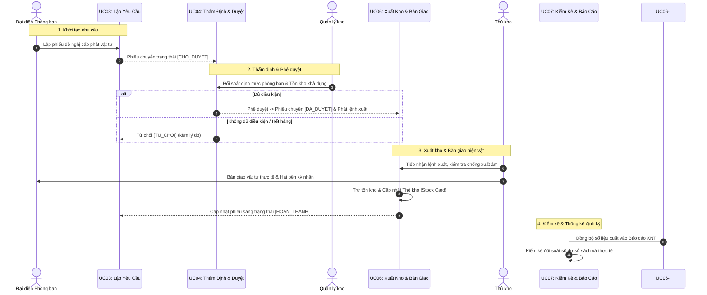

# SƠ ĐỒ TƯƠNG TÁC VÀ LUỒNG NGHIỆP VỤ GIỮA 07 CA SỬ DỤNG CỐT LÕI

> **Học phần**: IT3120 - Phân tích và Thiết kế Hệ thống Thông tin  
> **Đề tài**: Hệ thống Quản lý Vật tư và Kho hàng Nội bộ Tổ chức (Nhóm 8 - G8)  
> **Mục đích tài liệu**: Trực quan hóa mối quan hệ phụ thuộc, luân chuyển trạng thái và luồng dữ liệu trao đổi giữa 07 Ca sử dụng (Use Case) cốt lõi của đề tài.

---

## I. SƠ ĐỒ TỔNG QUAN TƯƠNG TÁC GIỮA 07 CA SỬ DỤNG

```mermaid
flowchart TD
    %% Styling
    classDef foundation fill:#E8EAF6,stroke:#3F51B5,stroke-width:2px,color:#1A237E;
    classDef supply fill:#E8F5E9,stroke:#2E7D32,stroke-width:2px,color:#1B5E20;
    classDef request fill:#FFF3E0,stroke:#EF6C00,stroke-width:2px,color:#E65100;
    classDef audit fill:#F3E5F5,stroke:#7B1FA2,stroke-width:2px,color:#4A148C;

    %% --- GIAI ĐOẠN 1: NỀN TẢNG DỮ LIỆU & PHÂN QUYỀN ---
    subgraph Phase1 ["  GIAI ĐOẠN 1: THIẾT LẬP NỀN TẢNG & DANH MỤC  "]
        UC01["<b>UC01: Quản trị Người dùng & Phân quyền RBAC</b><br><i>(Cấp tài khoản, phân vai trò, danh mục phòng ban)</i>"]:::foundation
        UC02["<b>UC02: Quản lý Danh mục & Hồ sơ Vật tư</b><br><i>(Mã VT, quy cách, ĐVT, ngưỡng tồn an toàn Min/Max)</i>"]:::foundation
    end

    %% --- GIAI ĐOẠN 2: TÍCH LŨY NGUỒN HÀNG VÀO KHO ---
    subgraph Phase2 ["  GIAI ĐOẠN 2: NHẬP VẬT TƯ VÀO KHO  "]
        UC05["<b>UC05: Quản lý Nhập kho & Điều chuyển</b><br><i>(Tiếp nhận cấp trên, thu hồi, điều chuyển nội bộ)</i><br><b>➔ TĂNG TỒN KHO THỰC TẾ</b>"]:::supply
    end

    %% --- GIAI ĐOẠN 3: CHU TRÌNH CẤP PHÁT PHÒNG BAN ---
    subgraph Phase3 ["  GIAI ĐOẠN 3: TIẾN TRÌNH CẤP PHÁT CHO PHÒNG BAN  "]
        UC03["<b>UC03: Lập & Theo dõi Yêu cầu Cấp phát</b><br><i>(Đại diện phòng ban tạo phiếu xin đồ)</i>"]:::request
        UC04["<b>UC04: Thẩm định & Phê duyệt Yêu cầu</b><br><i>(Quản lý kho đối soát tồn kho & ra quyết định)</i>"]:::request
        UC06["<b>UC06: Quản lý Xuất kho & Bàn giao</b><br><i>(Thủ kho xuất hàng, ký biên bản, cảnh báo tồn thấp)</i><br><b>➔ GIẢM TỒN KHO THỰC TẾ</b>"]:::request
    end

    %% --- GIAI ĐOẠN 4: KIỂM SOÁT & BÁO CÁO TỔNG HỢP ---
    subgraph Phase4 ["  GIAI ĐOẠN 4: KIỂM SOÁT, KIỂM KÊ & THỐNG KÊ  "]
        UC07["<b>UC07: Kiểm kê Kho hàng & Báo cáo Thống kê</b><br><i>(Chốt tồn, đếm thực tế, sinh phiếu cân bằng, báo cáo XNT)</i>"]:::audit
    end

    %% ================= CÁC ĐƯỜNG TƯƠNG TÁC NGHIỆP VỤ =================

    %% UC01 cấp quyền cho toàn hệ thống
    UC01 ==>|1. Phân quyền & Định danh người dùng| UC03
    UC01 -.->|Cấu hình quyền hạn| UC04
    UC01 -.->|Cấu hình quyền hạn| UC05
    UC01 -.->|Cấu hình quyền hạn| UC06
    UC01 -.->|Cấu hình quyền hạn| UC07

    %% UC02 cung cấp danh mục chuẩn
    UC02 ==>|2. Cung cấp danh mục vật tư chuẩn & ngưỡng tồn| UC03
    UC02 -->|Khai báo mã & vị trí kệ lưu cất| UC05
    UC02 -->|Đối soát thông số & ngưỡng an toàn Min| UC06

    %% UC05 tăng hàng trong kho
    UC05 ==>|3. Tạo nguồn hàng sẵn sàng trong kho| UC04

    %% Tiến trình cấp phát liên hoàn (UC03 -> UC04 -> UC06)
    UC03 ==>|4. Gửi phiếu yêu cầu [CHO_DUYET]| UC04
    UC04 ==>|5. Lệnh xuất kho từ phiếu [DA_DUYET]| UC06
    UC06 -->|6. Cập nhật trạng thái phiếu [HOAN_THANH]| UC03

    %% Tương tác kiểm soát tồn kho & kiểm kê
    UC06 -.->|7. Cảnh báo khi Tồn <= Ngưỡng Min| UC02
    UC05 -->|8. Dữ liệu Thẻ kho Nhập & Điều chuyển| UC07
    UC06 -->|9. Dữ liệu Thẻ kho Xuất cấp phát| UC07
    UC07 ==>|10. Tự sinh phiếu cân bằng kho nếu có sai lệch thừa/thiếu| UC05
```

---

## II. BẢNG CHI TIẾT CÁC LUỒNG TƯƠNG TÁC & DỮ LIỆU TRAO ĐỔI

| STT | Luồng tương tác giữa các Use Case | Chi tiết Nghiệp vụ & Dữ liệu trao đổi |
|:---:|:---|:---|
| **1** | **`UC01` $\longrightarrow$ Toàn bộ hệ thống** | **Phân quyền và Định danh người dùng:**<br>• Cung cấp cơ chế xác thực và ma trận phân quyền 4 vai trò: `ROLE_ADMIN`, `ROLE_WAREHOUSE_MGR`, `ROLE_DEPT_STAFF`, `ROLE_WAREHOUSE_STAFF`.<br>• Cung cấp danh mục phòng ban nội bộ làm căn cứ để kiểm tra hạn mức cấp phát cho `UC03`. |
| **2** | **`UC02` $\longrightarrow$ `UC03`, `UC05`, `UC06`** | **Dữ liệu Danh mục gốc:**<br>• `UC03` tra cứu danh mục mã vật tư, đơn vị tính, quy cách để lập phiếu đề xuất.<br>• `UC05` gắn mã vật tư khi tiếp nhận hàng mới và chỉ định vị trí kệ kho.<br>• `UC06` đối soát ngưỡng tồn kho tối thiểu (`NguongToiThieu`) để kích hoạt cảnh báo thiếu hụt. |
| **3** | **`UC05` $\longrightarrow$ Kho hàng $\longrightarrow$ `UC04`** | **Tạo lập Tồn kho khả dụng:**<br>• Khi hàng được nhập vào kho qua `UC05`, hệ thống ghi tăng số lượng tồn kho.<br>• Đây là điều kiện tiên quyết để ở `UC04`, Quản lý kho có hàng sẵn sàng để duyệt cấp phát cho các phòng ban. |
| **4** | **`UC03` $\longrightarrow$ `UC04`** | **Kích hoạt luồng Thẩm định & Phê duyệt:**<br>• `UC03` gửi phiếu yêu cầu ở trạng thái `CHO_DUYET`.<br>• Hành động này kích hoạt (mở rộng luồng - `<<extend>>`) để Quản lý kho tại `UC04` vào thẩm định định mức, kiểm tra tồn kho và ra quyết định duyệt. |
| **5** | **`UC04` $\longrightarrow$ `UC06`** | **Căn cứ xuất kho bắt buộc:**<br>• `UC06` bắt buộc (`<<include>>`) phải dựa trên phiếu yêu cầu đã ở trạng thái `DA_DUYET` từ `UC04`.<br>• Thủ kho không được phép tự ý xuất kho nếu chưa có lệnh duyệt hợp lệ. |
| **6** | **`UC06` $\longrightarrow$ `UC03`** | **Khép kín vòng đời phiếu yêu cầu:**<br>• Sau khi Thủ kho xuất hàng và hai bên ký nhận bàn giao tại `UC06`, hệ thống tự động cập nhật trạng thái phiếu yêu cầu ở `UC03` sang `HOAN_THANH`. |
| **7** | **`UC06` $\longrightarrow$ `UC02`** | **Cảnh báo ngưỡng an toàn:**<br>• Sau mỗi giao dịch xuất kho, hệ thống kiểm tra: nếu `TonKho <= NguongToiThieu` (đã thiết lập ở `UC02`), hệ thống lập tức phát cảnh báo thiếu hàng trên Dashboard và gửi email cảnh báo. |
| **8** | **`UC05`, `UC06` $\longrightarrow$ `UC07`** | **Dữ liệu Thẻ kho cho Kiểm kê & Báo cáo:**<br>• Mọi biến động tăng kho từ `UC05` và giảm kho từ `UC06` đều được ghi log vào Thẻ kho (Stock Card).<br>• `UC07` sử dụng số liệu này để tính toán báo cáo Xuất - Nhập - Tồn (XNT) và chốt số dư sổ sách khi mở đợt kiểm kê. |
| **9** | **`UC07` $\longrightarrow$ `UC05` / `UC06`** | **Cân bằng và Điều chỉnh tồn kho:**<br>• Nếu kiểm kê thực tế phát hiện thừa hoặc thiếu so với sổ sách, `UC07` sẽ tự động sinh phiếu nhập/xuất cân đối để đồng bộ lại dữ liệu tồn kho thực tế cho hệ thống. |

---

## III. CHU TRÌNH LUÂN CHUYỂN TRẠNG THÁI (LIFECYCLE FLOW)

Dưới đây là sơ đồ tuần tự thể hiện đường đi của một yêu cầu cấp phát vật tư từ lúc sinh ra đến khi hoàn tất:



---

## IV. MA TRẬN PHỤ THUỘC GIỮA CÁC CA SỬ DỤNG (DEPENDENCY MATRIX)

| Use Case Nguồn | UC01 | UC02 | UC03 | UC04 | UC05 | UC06 | UC07 |
|:---|:---:|:---:|:---:|:---:|:---:|:---:|:---:|
| **UC01: Phân quyền RBAC** | — | Quyền Admin | Quyền Đơn vị | Quyền Quản lý | Quyền Thủ kho | Quyền Thủ kho | Quyền Quản lý |
| **UC02: Danh mục Vật tư** | — | — | Mã VT & ĐVT | Tồn an toàn | Mã & Vị trí | Ngưỡng Min | Danh mục kiểm kê |
| **UC03: Lập Yêu Cầu** | — | — | — | `<<extend>>` | — | — | Số liệu nhu cầu |
| **UC04: Thẩm Định Duyệt** | — | — | Kết quả duyệt | — | — | `<<include>>` | Lịch sử duyệt |
| **UC05: Nhập Kho** | — | — | — | Nguồn hàng | — | — | Số liệu nhập |
| **UC06: Xuất Kho** | — | Cảnh báo Min | Trạng thái xong| — | — | — | Số liệu xuất |
| **UC07: Kiểm Kê & Báo Cáo**| — | — | — | — | Cân bằng kho | Cân bằng kho | — |

---
*Tài liệu này được biên soạn bởi Nhóm 8 (IT3120) phục vụ việc giải trình kiến trúc tương tác ca sử dụng trước Hội đồng chấm đồ án.*
