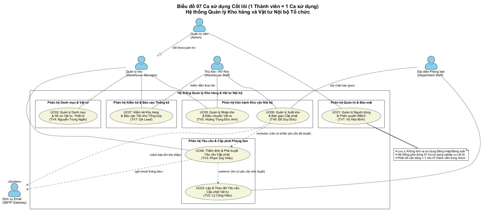

# 02 - Biểu đồ Ca sử dụng Tổng quan (07 Ca sử dụng Nghiệp vụ Cốt lõi)

> **Quy chuẩn đề tài**: Theo quy định của giảng viên hướng dẫn, **không tính ca sử dụng Đăng nhập/Đăng xuất** (xem là cơ chế kỹ thuật nền tảng của hệ thống). Hệ thống bao gồm tối đa **07 Ca sử dụng nghiệp vụ cốt lõi**, phân công cân bằng **1 thành viên = 1 Ca sử dụng trọn gói (Owner)**.

---

## 1. Danh sách các Tác nhân (Actors)

| Tác nhân | Loại | Trọng số UCP | Vai trò & Trách nhiệm chính trong hệ thống |
|:---|:---:|:---:|:---|
| **Quản trị viên (Admin)** | Complex | 3 | Quản trị tài khoản, gán/thu hồi vai trò RBAC, cấu hình hệ thống và giám sát nhật ký an toàn |
| **Quản lý kho (Warehouse Manager)** | Complex | 3 | Quản lý danh mục vật tư, thẩm định duyệt cấp phát, điều chuyển, mở đợt kiểm kê và xem báo cáo |
| **Đại diện Phòng ban (Department Staff)**| Complex | 3 | Lập phiếu yêu cầu cấp phát vật tư/thiết bị theo định mức của đơn vị, theo dõi tiến độ và ký nhận |
| **Thủ kho / NV Kho (Warehouse Staff)** | Complex | 3 | Tiếp nhận phân bổ nhập kho, xuất kho bàn giao hiện vật, thực hiện kiểm đếm thực tế |
| **Dịch vụ Email (SMTP Gateway)** | Simple | 1 | Hệ thống ngoài nhận thông báo tự động phê duyệt yêu cầu và cảnh báo vật tư thiếu hụt |

$$\mathbf{UAW = 4 \times 3 + 1 \times 1 = 12 + 1 = 13}$$

---

## 2. Danh sách 07 Ca sử dụng Cốt lõi & Phân công Thành viên

| Mã UC | Tên Ca sử dụng | Tác nhân chính | Phân hệ nghiệp vụ | Số GD | Phân loại | UUCW | Thành viên phụ trách chính (Owner) |
|:---:|:---|:---|:---|:---:|:---:|:---:|:---|
| **UC01** | **Quản trị Người dùng & Phân quyền RBAC** | Quản trị viên (Admin) | Quản trị & Bảo mật | 6 | Average | 10 | **Vũ Hòa Bình** *(TV1 - Lead PM)* |
| **UC02** | **Quản lý Danh mục & Hồ sơ Vật tư, Thiết bị** | Quản lý kho | Danh mục & Vật tư | 8 | Complex | 15 | **Nguyễn Trung Ngân** *(TV4 - DB Lead)* |
| **UC03** | **Lập & Theo dõi Yêu cầu Cấp phát Vật tư** | Đại diện Phòng ban | Yêu cầu & Cấp phát | 9 | Complex | 15 | **Lý Công Hiếu** *(TV2 - Lead BA 1)* |
| **UC04** | **Thẩm định & Phê duyệt Yêu cầu Cấp phát** | Quản lý kho | Yêu cầu & Cấp phát | 6 | Average | 10 | **Phạm Duy Hiếu** *(TV3 - Lead BA 2)* |
| **UC05** | **Quản lý Nhập kho & Điều chuyển Vật tư** | Thủ kho / NV Kho | Vận hành Kho vận | 10 | Complex | 15 | **Hoàng Trọng Đức Anh** *(TV5 - Architect)* |
| **UC06** | **Quản lý Xuất kho & Bàn giao Cấp phát** | Thủ kho / NV Kho | Vận hành Kho vận | 10 | Complex | 15 | **Đỗ Duy Đức** *(TV6 - UI Specialist)* |
| **UC07** | **Kiểm kê Kho hàng & Báo cáo Thống kê** | Quản lý kho | Kiểm kê & Báo cáo | 12 | Complex | 15 | **Thành viên 7** *(TV7 - QA Lead)* |

### Tổng hợp Trọng số Ca sử dụng Chưa hiệu chỉnh (UUCW):
- **Số ca sử dụng Average**: 2 ca (UC01, UC04) $\rightarrow 2 \times 10 = 20\ \text{điểm}$
- **Số ca sử dụng Complex**: 5 ca (UC02, UC03, UC05, UC06, UC07) $\rightarrow 5 \times 15 = 75\ \text{điểm}$

$$\mathbf{UUCW = 20 + 75 = 95\ \text{điểm}}$$

---

## 3. Mối quan hệ giữa các Ca sử dụng

### 3.1 Quan hệ Include (Bao gồm)
- **`UC06` (Quản lý Xuất kho & Bàn giao Cấp phát) $\xrightarrow{\ll include\gg}$ `UC04` (Thẩm định & Phê duyệt Yêu cầu Cấp phát)**:
  *Lý do nghiệp vụ*: Thủ kho chỉ được phép lập phiếu xuất kho cấp phát khi đã có căn cứ từ một phiếu yêu cầu cấp phát ở trạng thái `DA_DUYET`.

### 3.2 Quan hệ Extend (Mở rộng)
- **`UC04` (Thẩm định & Phê duyệt Yêu cầu Cấp phát) $\xleftarrow{\ll extend\gg}$ `UC03` (Lập & Theo dõi Yêu cầu Cấp phát Vật tư)**:
  *Điểm mở rộng*: Kích hoạt quy trình thẩm định khi phòng ban xác nhận gửi phiếu yêu cầu ở trạng thái `CHO_DUYET`.

---

## 4. Sơ đồ Ca sử dụng Tổng quan

File mã nguồn PlantUML: [use-case-diagram.puml](../plantuml/use-case-diagram.puml)