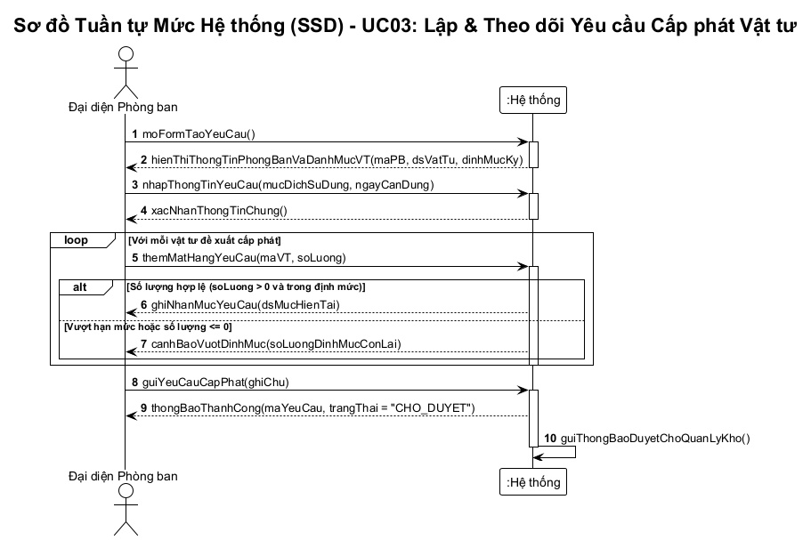
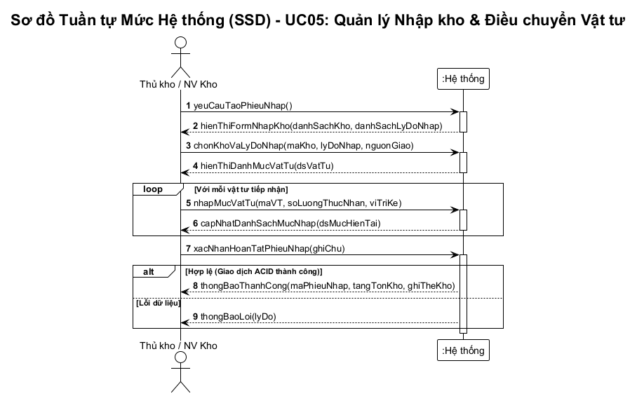
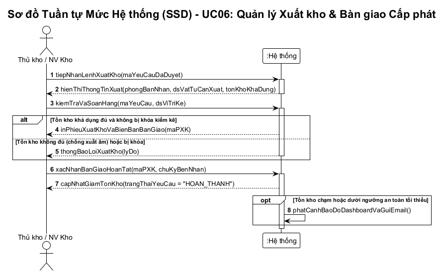
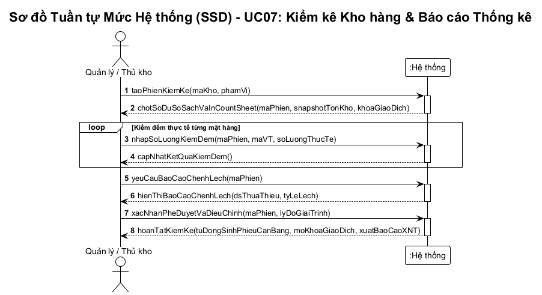

# 07 - Sơ đồ Tuần tự Mức Hệ thống (System Sequence Diagrams - SSD)

## Khái niệm và Vai trò

Theo giáo trình **IT3120 - Mô hình hóa Hành vi (Behavioral Modeling)**:
- **System Sequence Diagram (SSD)** mô tả tương tác giữa các tác nhân bên ngoài (Actors) và hệ thống trong phạm vi một ca sử dụng (Use Case).
- Hệ thống được coi như một **hộp đen (Black Box)** đại diện bởi đối tượng `:Hệ thống` (`:System`).
- SSD định nghĩa rõ các **sự kiện hệ thống (System Events)** và thông điệp phản hồi (Return Messages / Data Displays).

Dưới đây là các SSD chuẩn hóa tương ứng với **07 Ca sử dụng nghiệp vụ cốt lõi** của hệ thống.

---

## 1. SSD cho UC01: Quản trị Người dùng & Phân quyền RBAC
- **Tác nhân**: Quản trị viên (Admin).
- **Sự kiện chính**:
  1. `truyCapQuanTriNguoiDung()`: Hiển thị danh sách nhân viên và tài khoản.
  2. `yeuCauCapTaiKhoan(maNV, tenDangNhap, dsVaiTro)`: Gán vai trò trong ma trận RBAC.
  3. `xacNhanLuuPhanQuyen(maNV, dsVaiTro)`: Băm mật khẩu (Bcrypt), lưu CSDL và ghi Audit Log.

---

## 2. SSD cho UC02: Quản lý Danh mục & Hồ sơ Vật tư, Thiết bị
- **Tác nhân**: Quản lý kho.
- **Sự kiện chính**:
  1. `moGiaoDienDanhMucVatTu()`: Tải cây danh mục phân cấp và danh sách vật tư.
  2. `themMoiVatTu(maVT, tenVT, donViTinh, quyCach, maDanhMucCha, nguongMin, nguongMax)`: Thiết lập thông số và ngưỡng tồn kho an toàn tối thiểu/tối đa.

---

## 3. SSD cho UC03: Lập & Theo dõi Yêu cầu Cấp phát Vật tư
- **Tác nhân**: Đại diện Phòng ban.
- **Sự kiện chính**:
  1. `moFormTaoYeuCau()`: Mở form yêu cầu cấp phát, hiển thị định mức kỳ của đơn vị.
  2. `nhapThongTinYeuCau(mucDichSuDung, ngayCanDung)`: Nhập mục đích và thời hạn cần tiếp nhận vật tư.
  3. `themMatHangYeuCau(maVT, soLuong)`: Lập danh sách vật tư đề nghị cấp phát, hệ thống tự động kiểm tra định mức kỳ.
  4. `guiYeuCauCapPhat(ghiChu)`: Chuyển phiếu yêu cầu sang trạng thái `CHO_DUYET` và gửi thông báo cho Quản lý kho.

---

## 4. SSD cho UC04: Thẩm định & Phê duyệt Yêu cầu Cấp phát
- **Tác nhân**: Quản lý kho.
- **Sự kiện chính**:
  1. `moDanhSachYeuCauChoDuyet()`: Hiển thị các phiếu yêu cầu đang chờ thẩm định.
  2. `xemChiTietThamDinh(maYeuCau)`: Đối soát nhu cầu với tồn kho khả dụng thực tế.
  3. `xacNhanPheDuyet(maYeuCau, dsSoLuongDuyet)`: Phê duyệt đủ hoặc một phần, chuyển trạng thái `DA_DUYET` và phát lệnh xuất kho.
  4. `xacNhanTuChoi(maYeuCau, lyDoTuChoi)`: Từ chối yêu cầu kèm lý do bắt buộc và gửi email phản hồi.

---

## 5. SSD cho UC05: Quản lý Nhập kho & Điều chuyển Vật tư
- **Tác nhân**: Thủ kho / Nhân viên kho.
- **Sự kiện chính**:
  1. `yeuCauTaoPhieuNhap()`: Khởi tạo phiên làm việc nhập kho.
  2. `chonKhoVaLyDoNhap(maKho, lyDoNhap, nguonGiao)`: Xác định kho nhận và căn cứ tiếp nhận (bàn giao phân bổ, hoàn nhập phòng ban, điều chuyển giữa các kho).
  3. `nhapMucVatTu(maVT, soLuongThucNhan, viTriKe)`: Vòng lặp nhập chi tiết từng mặt hàng và chỉ định vị trí Dãy Kệ - Tầng - Ô.
  4. `xacNhanHoanTatPhieuNhap(ghiChu)`: Chốt phiếu, thực thi Transaction ACID tăng tồn kho và ghi Thẻ kho.

---

## 6. SSD cho UC06: Quản lý Xuất kho & Bàn giao Cấp phát
- **Tác nhân**: Thủ kho / Nhân viên kho.
- **Sự kiện chính**:
  1. `tiepNhanLenhXuatKho(maYeuCauDaDuyet)`: Kế thừa thông tin từ phiếu yêu cầu đã duyệt từ UC04.
  2. `kiemTraVaSoanHang(maYeuCau, dsViTriKe)`: Kiểm tra chống xuất âm và khóa kiểm kê; in phiếu xuất kho và biên bản bàn giao.
  3. `xacNhanBanGiaoHoanTat(maPXK, chuKyBenNhan)`: Trừ tồn kho nguyên tử, cập nhật trạng thái yêu cầu sang `HOAN_THANH`, tự động phát cảnh báo nếu tồn kho $\le$ ngưỡng tối thiểu.

---

## 7. SSD cho UC07: Kiểm kê Kho hàng & Báo cáo Thống kê
- **Tác nhân**: Quản lý kho, Nhân viên kho.
- **Sự kiện chính**:
  1. `taoPhienKiemKe(maKho, phamVi)`: Chốt số liệu sổ sách (Stock Snapshot) và tạm khóa giao dịch xuất/nhập.
  2. `nhapSoLuongKiemDem(maPhien, maVT, soLuongThucTe)`: Nhân viên kho cập nhật số đếm thực tế theo từng ô/kệ.
  3. `yeuCauBaoCaoChenhLech(maPhien)`: Hệ thống tổng hợp báo cáo sai lệch thừa/thiếu.
  4. `xacNhanPheDuyetVaDieuChinh(maPhien, lyDoGiaiTrinh)`: Tự động sinh phiếu cân bằng kho, mở khóa giao dịch và xuất báo cáo XNT.

---

## File nguồn PlantUML
File PlantUML hoàn chỉnh: [ssd.puml](../plantuml/ssd.puml).