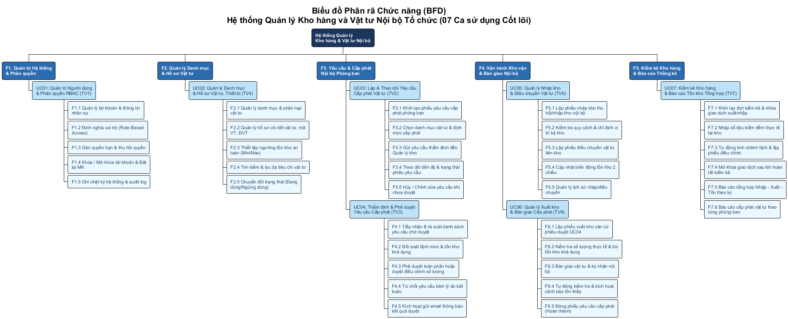
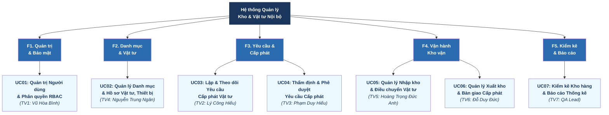
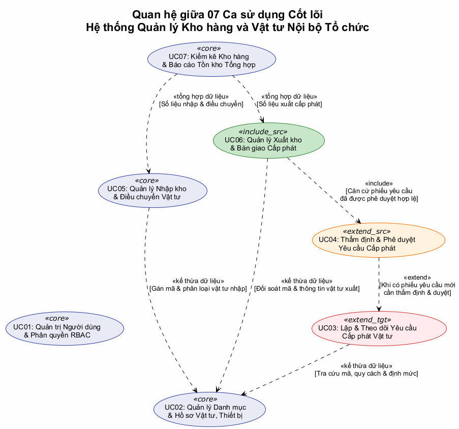
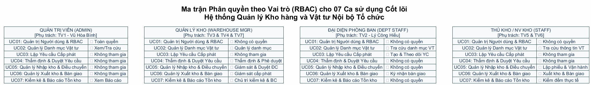

# Mô hình Chức năng Chi tiết — Hệ thống Quản lý Kho hàng và Vật tư Nội bộ Tổ chức

> **Học phần**: IT3120 – Phân tích và Thiết kế Hệ thống Thông tin  
> **Đại học Bách Khoa Hà Nội (HUST)** — Nhóm G8  
> **Phương pháp**: Phân tích chức năng theo tiến trình EUP, sử dụng UML 2.5  
> **Quy chuẩn đề tài**: **Không tính ca sử dụng Đăng nhập/Đăng xuất**; Giới hạn đúng **07 Ca sử dụng nghiệp vụ cốt lõi** phân bổ cân bằng **1 Thành viên = 1 Ca sử dụng trọn gói (Owner)**; Quản lý tài sản nội bộ — **Hoàn toàn không có nghiệp vụ mua bán thương mại**.

---

## 1. Tổng quan Mô hình Chức năng

Mô hình chức năng (Functional Model) là thành phần cốt lõi trong giai đoạn **Phân tích hệ thống**, đặc tả **hệ thống làm gì** (what) chứ không phải **làm như thế nào** (how). Mô hình bao gồm:

| Thành phần | Mục đích | Tài liệu tham chiếu |
|:--|:--|:--|
| Biểu đồ phân rã chức năng (BFD) | Phân rã hệ thống thành các nhóm chức năng con | Mục 2 |
| Biểu đồ Ca sử dụng (Use Case Diagram) | Xác định tác nhân và 07 ca sử dụng cốt lõi | [02-use-case-diagram.md](./02-use-case-diagram.md) |
| Đặc tả Ca sử dụng (Use Case Specs) | Mô tả chi tiết luồng sự kiện 07 UC | [03-use-case-specs.md](./03-use-case-specs.md) |
| Biểu đồ Hoạt động (Activity Diagrams) | Mô hình hóa luồng công việc nghiệp vụ | [04-activity-diagrams.md](./04-activity-diagrams.md) |
| Ma trận CRUD | Ánh xạ 07 ca sử dụng ↔ 18 thực thể dữ liệu | Mục 5 |
| Danh mục Quy tắc nghiệp vụ (Business Rules) | 41 quy tắc kiểm soát hệ thống | Mục 6 |

---

## 2. Biểu đồ Phân rã Chức năng (Business Function Decomposition – BFD)

Phân rã hệ thống từ mức tổng quát xuống **07 Ca sử dụng nghiệp vụ cốt lõi** tương ứng với 07 thành viên trong nhóm dự án:

File mã nguồn PlantUML: [functional-model-bfd.puml](../plantuml/functional-model-bfd.puml)

---

## 3. Đặc tả Chi tiết 07 Ca sử dụng Cốt lõi theo 5 Phân hệ BFD

### 3.1 Phân hệ F1: Quản trị & Bảo mật
#### UC01: Quản trị Người dùng & Phân quyền RBAC *(Chủ trì: TV1 - Vũ Hòa Bình)*

| Thuộc tính | Nội dung |
|:--|:--|
| **Mô tả** | Quản lý thông tin hồ sơ nhân sự, danh mục phòng ban nội bộ, cấp phát tài khoản hệ thống, gán/thu hồi vai trò theo mô hình RBAC và ghi nhật ký kiểm toán an toàn (Audit Log) |
| **Tác nhân** | Quản trị viên (Admin) |
| **Độ phức tạp** | Average (6 transactions) — 10 UUCW |
| **Dữ liệu đầu vào** | Hồ sơ nhân viên, mã phòng ban, tên đăng nhập, vai trò gán (`ROLE_ADMIN`, `ROLE_WAREHOUSE_MGR`, `ROLE_DEPT_STAFF`, `ROLE_WAREHOUSE_STAFF`), danh sách quyền hạn |
| **Dữ liệu đầu ra** | Tài khoản kích hoạt, ma trận quyền RBAC cập nhật, bảng ghi log kiểm toán |
| **Quy tắc nghiệp vụ** | BR01: Mã hóa Bcrypt; BR02: Nguyên tắc đặc quyền tối thiểu; BR03: Khóa tài khoản sau 5 lần nhập sai; BR30: Mã phòng ban duy nhất; BR39: CCCD/Email duy nhất; BR40: Mật khẩu đổi lần đầu; BR41: Không xóa vật lý |

**Các chức năng chi tiết cấu thành UC01:**

| ID | Chức năng con | Mô tả chi tiết | Quy tắc nghiệp vụ |
|:--|:--|:--|:--|
| F1.1 | Quản lý hồ sơ nhân sự | Thêm, cập nhật thông tin nhân viên, liên kết phòng ban trực thuộc | BR39, BR41 |
| F1.2 | Quản lý danh mục phòng ban | Khai báo cơ cấu tổ chức, thiết lập định mức hạn mức cấp phát cho đơn vị | BR30, BR31 |
| F1.3 | Cấp phát & Khóa tài khoản | Tạo tài khoản đăng nhập, khóa/mở khóa khi nhân viên chuyển công tác | BR03, BR40 |
| F1.4 | Cấu hình vai trò & Quyền hạn | Thiết lập vai trò và gán quyền chức năng (Read, Write, Delete, Approve, Export) | BR02 |
| F1.5 | Gán vai trò cho tài khoản | Liên kết tài khoản nhân viên với một hoặc nhiều vai trò trong ma trận RBAC | — |
| F1.6 | Ghi nhật ký kiểm toán | Lưu vết thời điểm, IP, hành động phân quyền vào `AuditLog` | BR08 |

---

### 3.2 Phân hệ F2: Danh mục & Vật tư
#### UC02: Quản lý Danh mục & Hồ sơ Vật tư, Thiết bị *(Chủ trì: TV4 - Nguyễn Trung Ngân)*

| Thuộc tính | Nội dung |
|:--|:--|
| **Mô tả** | Thiết lập cây danh mục phân cấp hình cây (nhóm/loại), quản lý hồ sơ thông số kỹ thuật, quy cách đóng gói, đơn vị tính chuẩn, thiết lập ngưỡng tồn kho an toàn và bộ lọc tra cứu |
| **Tác nhân** | Quản lý kho (Warehouse Manager) |
| **Độ phức tạp** | Complex (8 transactions) — 15 UUCW |
| **Dữ liệu đầu vào** | Mã danh mục, mã vật tư, tên, đơn vị tính, quy cách kỹ thuật, ngưỡng tồn an toàn tối thiểu/tối đa, vị trí lưu cất mặc định |
| **Dữ liệu đầu ra** | Cây danh mục phân cấp, hồ sơ vật tư lưu hành, ngưỡng cảnh báo thiết lập |
| **Quy tắc nghiệp vụ** | BR04: Mã VT duy nhất; BR06: Ngưỡng tồn an toàn ≥ 0; BR07: Không sửa mã VT; BR09: Không xóa vật lý khi đã có giao dịch; BR10: Tên danh mục duy nhất trong cùng cấp; BR11: Không tạo vòng lặp cây danh mục; BR12: Không xóa danh mục đang có vật tư |

**Các chức năng chi tiết cấu thành UC02:**

| ID | Chức năng con | Mô tả chi tiết | Quy tắc nghiệp vụ |
|:--|:--|:--|:--|
| F2.1 | Quản lý cây danh mục phân cấp | Thêm, sửa, xóa danh mục cha - con (ngăn chặn đệ quy vô hạn) | BR10, BR11, BR12 |
| F2.2 | Thêm mới & Cập nhật hồ sơ VT | Khai báo mã VT duy nhất, tên, quy cách, đơn vị tính chuẩn | BR04, BR07 |
| F2.3 | Cấu hình ngưỡng tồn an toàn | Thiết lập ngưỡng tồn tối thiểu (Min) và tối đa (Max) cho từng loại vật tư tại từng kho | BR06 |
| F2.4 | Định vị vị trí kệ kho mặc định | Gán vị trí Dãy - Kệ - Tầng - Ô mặc định để phục vụ chỉ dẫn khi nhập hàng | — |
| F2.5 | Chuyển đổi trạng thái lưu hành | Chuyển trạng thái `DANG_SU_DUNG` sang `TAM_NGUNG` hoặc `NGUNG_SU_DUNG` | BR09 |
| F2.6 | Tìm kiếm & Bộ lọc nâng cao | Tra cứu nhanh đa tiêu chí theo mã, tên, danh mục, trạng thái tồn | — |

---

### 3.3 Phân hệ F3: Yêu cầu & Cấp phát
#### UC03: Lập & Theo dõi Yêu cầu Cấp phát Vật tư *(Chủ trì: TV2 - Lý Công Hiếu)*

| Thuộc tính | Nội dung |
|:--|:--|
| **Mô tả** | Cán bộ đại diện phòng ban tạo phiếu đề nghị cấp phát vật tư/thiết bị theo nhu cầu công tác, hệ thống tự động đối chiếu hạn mức kỳ của phòng ban và cho phép theo dõi tiến độ xử lý |
| **Tác nhân** | Đại diện Phòng ban (Department Staff) |
| **Độ phức tạp** | Complex (9 transactions) — 15 UUCW |
| **Dữ liệu đầu vào** | Mã phòng ban, mục đích sử dụng (trang bị mới, sửa chữa, định kỳ), ngày cần nhận, danh sách vật tư và số lượng yêu cầu |
| **Dữ liệu đầu ra** | Phiếu yêu cầu (`YC-YYYYMMDD-XXX`) ở trạng thái `CHO_DUYET`, thông báo gửi tới Quản lý kho |
| **Quy tắc nghiệp vụ** | BR32: Mã yêu cầu duy nhất; BR33: Mục đích bắt buộc; BR34: Số lượng yêu cầu > 0; BR35: Cảnh báo vượt định mức phòng ban; BR36: Ngày cần dùng hợp lệ |

**Các chức năng chi tiết cấu thành UC03:**

| ID | Chức năng con | Mô tả chi tiết | Quy tắc nghiệp vụ |
|:--|:--|:--|:--|
| F3.1 | Khởi tạo phiếu yêu cầu | Tự sinh mã phiếu chuẩn (`YC-YYYYMMDD-XXX`), gán thời điểm và phòng ban | BR32, BR33 |
| F3.2 | Thêm mặt hàng đề nghị | Chọn vật tư từ danh mục lưu hành, nhập số lượng cần cấp | BR34 |
| F3.3 | Kiểm tra định mức phòng ban | Tự động so sánh số lượng yêu cầu với định mức kỳ còn lại của đơn vị | BR35 |
| F3.4 | Gửi yêu cầu chờ duyệt | Lưu phiếu ở trạng thái `CHO_DUYET`, kích hoạt thông báo tới Quản lý kho | BR36 |
| F3.5 | Theo dõi tiến độ xử lý | Hiển thị trạng thái phiếu theo timeline (Chờ duyệt, Đã duyệt, Đang xuất, Hoàn thành, Từ chối) | — |
| F3.6 | Hủy phiếu yêu cầu | Cho phép người tạo hủy phiếu khi phiếu vẫn đang ở trạng thái `CHO_DUYET` | — |

---

#### UC04: Thẩm định & Phê duyệt Yêu cầu Cấp phát *(Chủ trì: TV3 - Phạm Duy Hiếu)*

| Thuộc tính | Nội dung |
|:--|:--|
| **Mô tả** | Quản lý kho tiếp nhận hàng đợi yêu cầu chờ duyệt, đối soát tính hợp lý và tồn kho khả dụng thực tế để ra quyết định Duyệt toàn phần, Duyệt một phần hoặc Từ chối kèm lý do |
| **Tác nhân** | Quản lý kho (Warehouse Manager) |
| **Độ phức tạp** | Average (6 transactions) — 10 UUCW |
| **Dữ liệu đầu vào** | Mã phiếu yêu cầu, tồn kho khả dụng hiện tại, số lượng phê duyệt cho từng mục, lý do từ chối (nếu có) |
| **Dữ liệu đầu ra** | Phiếu chuyển sang `DA_DUYET` hoặc `TU_CHOI`, lệnh xuất kho tự động chuyển sang Thủ kho, email thông báo kết quả |
| **Quy tắc nghiệp vụ** | BR37: Lý do từ chối bắt buộc; BR21: Tồn kho khả dụng kiểm tra trước khi duyệt; BR38: Số lượng duyệt ≤ số lượng yêu cầu |

**Các chức năng chi tiết cấu thành UC04:**

| ID | Chức năng con | Mô tả chi tiết | Quy tắc nghiệp vụ |
|:--|:--|:--|:--|
| F3.7 | Tiếp nhận hàng đợi chờ duyệt | Liệt kê các phiếu `CHO_DUYET` sắp xếp theo thời gian và mức độ ưu tiên | — |
| F3.8 | Thẩm định tồn kho khả dụng | Tra cứu tồn khả dụng thực tế (`TonKho - DaGiuCho`) của từng mặt hàng xin cấp | BR21 |
| F3.9 | Phê duyệt toàn phần (100%) | Chấp thuận cấp đủ số lượng yêu cầu khi nhu cầu hợp lý và kho đủ hàng | BR38 |
| F3.10| Phê duyệt một phần | Điều chỉnh giảm số lượng duyệt dựa trên tồn kho thực tế và nhu cầu cấp bách | BR38 |
| F3.11| Từ chối yêu cầu | Chuyển trạng thái sang `TU_CHOI`, bắt buộc nhập lý do từ chối cụ thể | BR37 |
| F3.12| Phát lệnh xuất kho & Thông báo | Chuyển trạng thái phiếu sang `DA_DUYET`, tạo lệnh xuất kho và gửi email thông báo | — |

---

### 3.4 Phân hệ F4: Vận hành Kho vận
#### UC05: Quản lý Nhập kho & Điều chuyển Vật tư *(Chủ trì: TV5 - Hoàng Trọng Đức Anh)*

| Thuộc tính | Nội dung |
|:--|:--|
| **Mô tả** | Tiếp nhận vật tư phân bổ từ cấp trên, thu hồi hoàn nhập từ phòng ban, hoặc điều chuyển giữa các kho nội bộ; kiểm đếm thực nhận, chỉ định vị trí lưu cất và cập nhật tăng tồn kho nguyên tử |
| **Tác nhân** | Thủ kho / Nhân viên kho (Warehouse Staff) |
| **Độ phức tạp** | Complex (10 transactions) — 15 UUCW |
| **Dữ liệu đầu vào** | Mã kho nhận, lý do nhập (`PHAN_BO_CAP_TREN`, `HOAN_NHAP_PHONG_BAN`, `CHUYEN_KHO_DEN`), biên bản bàn giao, số lượng thực nhận, vị trí ô/kệ |
| **Dữ liệu đầu ra** | Phiếu nhập kho (`PNK-YYYYMMDD-XXX`), tồn kho tăng tức thì (`TonKho += soLuongThucNhan`), thẻ kho (Stock Card) được ghi nhận |
| **Quy tắc nghiệp vụ** | BR13: Mã phiếu nhập duy nhất; BR14: Ghi rõ nguồn bàn giao; BR15: Số lượng thực nhận > 0; BR16: Vật tư ở trạng thái lưu hành; BR18: Cập nhật tồn kho transaction ACID; BR19: Biên bản ký nhận đầy đủ; BR25: Khớp lệnh điều chuyển 2 đầu kho |

**Các chức năng chi tiết cấu thành UC05:**

| ID | Chức năng con | Mô tả chi tiết | Quy tắc nghiệp vụ |
|:--|:--|:--|:--|
| F4.1 | Khởi tạo phiếu nhập kho | Tự sinh mã (`PNK-YYYYMMDD-XXX`), chọn kho nhận và nguồn tiếp nhận | BR13, BR14 |
| F4.2 | Kiểm đếm & Ghi nhận thực nhận | Đối soát quy cách, số lượng thực tế nhận bàn giao so với chứng từ gửi | BR15, BR16 |
| F4.3 | Định vị vị trí kệ kho | Chỉ định chính xác vị trí Dãy - Kệ - Tầng - Ô lưu cất hiện vật | — |
| F4.4 | Xử lý điều chuyển kho nội bộ | Tiếp nhận lệnh điều chuyển, đối soát số xuất kho nguồn và số nhập kho đích | BR25 |
| F4.5 | Tăng tồn kho nguyên tử | Thực thi Transaction ACID cập nhật tức thời số lượng tồn kho | BR18 |
| F4.6 | Cập nhật thẻ kho (Stock Card) | Ghi nhận biến động tăng tồn kho vào lịch sử giao dịch kế toán nội bộ | BR18 |

---

#### UC06: Quản lý Xuất kho & Bàn giao Cấp phát *(Chủ trì: TV6 - Đỗ Duy Đức)*

| Thuộc tính | Nội dung |
|:--|:--|
| **Mô tả** | Lập phiếu xuất kho căn cứ theo yêu cầu đã duyệt (từ UC04), kiểm tra chống xuất âm và khóa kiểm kê, in phiếu xuất, bàn giao hiện vật cho cán bộ phòng ban, ký nhận biên bản, trừ tồn kho và kích hoạt cảnh báo tồn an toàn |
| **Tác nhân** | Thủ kho / Nhân viên kho (Warehouse Staff) |
| **Độ phức tạp** | Complex (10 transactions) — 15 UUCW |
| **Dữ liệu đầu vào** | Mã yêu cầu đã duyệt (`DA_DUYET`), danh sách vật tư cần xuất, chữ ký bên giao và bên nhận |
| **Dữ liệu đầu ra** | Phiếu xuất kho (`PXK-YYYYMMDD-XXX`), biên bản bàn giao 2 bên, tồn kho giảm tức thì, cảnh báo đỏ nếu tồn $\le$ ngưỡng an toàn |
| **Quy tắc nghiệp vụ** | BR20: Mã phiếu xuất duy nhất; BR21: Số lượng xuất ≤ tồn khả dụng (chống xuất âm); BR23: Không xuất vật tư đang khóa kiểm kê; BR24: Trừ tồn kho an toàn; BR38: Số lượng bàn giao ≤ số lượng đã duyệt |

**Các chức năng chi tiết cấu thành UC06:**

| ID | Chức năng con | Mô tả chi tiết | Quy tắc nghiệp vụ |
|:--|:--|:--|:--|
| F4.7 | Tiếp nhận lệnh xuất theo phiếu duyệt | Kế thừa thông tin từ phiếu yêu cầu cấp phát đã ở trạng thái `DA_DUYET` | Include UC04 |
| F4.8 | Kiểm soát điều kiện xuất kho | Kiểm tra số lượng tồn khả dụng (chống xuất âm) và kiểm tra khóa kiểm kê | BR21, BR23 |
| F4.9 | Soạn hàng & In phiếu xuất kho | Chỉ dẫn vị trí kệ cất hàng, in Phiếu xuất kho theo mẫu kế toán quy chuẩn | — |
| F4.10| Bàn giao hiện vật & Ký nhận | Thủ kho giao hàng cho cán bộ phòng ban nhận, ký xác nhận biên bản bàn giao | BR38 |
| F4.11| Trừ tồn kho nguyên tử | Giảm số lượng tồn kho (`TonKho -= soLuongXuat`), chuyển trạng thái yêu cầu sang `HOAN_THANH` | BR24 |
| F4.12| Kích hoạt cảnh báo tồn an toàn | So sánh nếu `TonKho <= NguongToiThieu` $\rightarrow$ Tự động phát cảnh báo trên Dashboard và gửi email | BR06 |

---

### 3.5 Phân hệ F5: Kiểm kê & Báo cáo
#### UC07: Kiểm kê Kho hàng & Báo cáo Thống kê *(Chủ trì: TV7 - QA Lead)*

| Thuộc tính | Nội dung |
|:--|:--|
| **Mô tả** | Tổ chức đợt kiểm kê hiện vật định kỳ/đột xuất, chốt số dư sổ sách tại thời điểm kiểm kê (Stock Snapshot), tạm khóa giao dịch, nhập số lượng đếm thực tế, đối soát tính sai lệch thừa/thiếu, tự sinh phiếu cân bằng kho và kết xuất báo cáo tổng hợp |
| **Tác nhân** | Quản lý kho (Warehouse Manager) |
| **Độ phức tạp** | Complex (12 transactions) — 15 UUCW |
| **Dữ liệu đầu vào** | Mã kho kiểm kê, phạm vi (toàn kho hoặc theo nhóm vật tư), số lượng đếm thực tế, lý do giải trình chênh lệch |
| **Dữ liệu đầu ra** | Phiếu kiểm kê (`PKK-YYYYMMDD-XXX`), phiếu cân bằng kho tự sinh, bộ Báo cáo Xuất - Nhập - Tồn (XNT) và Báo cáo Cấp phát theo phòng ban |
| **Quy tắc nghiệp vụ** | BR26: Tối đa 1 phiên kiểm kê mở/kho; BR27: Khóa giao dịch xuất/nhập trong phạm vi kiểm kê; BR28: Bắt buộc giải trình chênh lệch; BR29: Tự động cân bằng kho sau khi duyệt; BR41: Công thức cân đối kế toán XNT |

**Các chức năng chi tiết cấu thành UC07:**

| ID | Chức năng con | Mô tả chi tiết | Quy tắc nghiệp vụ |
|:--|:--|:--|:--|
| F5.1 | Khởi tạo đợt kiểm kê kho | Chọn kho, thời điểm bắt đầu và thành lập hội đồng kiểm kê | BR26 |
| F5.2 | Chốt tồn sổ sách & Khóa giao dịch| Chụp ảnh số dư tồn kho (Stock Snapshot), tạm khóa xuất/nhập phạm vi kiểm kê | BR27 |
| F5.3 | Xuất bảng kiểm đếm (Count sheet) | Sinh biểu mẫu kiểm đếm không hiển thị số dư sổ sách cho nhân viên đếm thực tế | — |
| F5.4 | Nhập kết quả kiểm đếm thực tế | Nhập số lượng thực tế đếm được tại từng ô/kệ kho | — |
| F5.5 | Đối soát & Tính sai lệch thừa/thiếu| Tính toán: `ChenhLech = SL_ThucTe - SL_SoSach` (phân loại Khớp, Thừa, Thiếu) | — |
| F5.6 | Nhập biên bản giải trình sai lệch | Yêu cầu nhập lý do giải trình bắt buộc đối với các mục có phát sinh chênh lệch | BR28 |
| F5.7 | Phê duyệt & Tự sinh phiếu cân bằng| Tự động sinh phiếu nhập cân đối (nếu thừa) hoặc xuất cân đối (nếu thiếu), cập nhật lại tồn kho | BR29 |
| F5.8 | Mở khóa giao dịch kho | Mở lại quyền xuất/nhập kho bình thường sau khi chốt phiên kiểm kê | — |
| F5.9 | Kết xuất Báo cáo Xuất - Nhập - Tồn | Tổng hợp cân đối kỳ: `TonCuoi = TonDau + TongNhap - TongXuat` ra file Excel/PDF | BR41 |
| F5.10| Thống kê cấp phát theo phòng ban | Thống kê số lượng, cơ cấu vật tư đã cấp phát cho từng đơn vị phục vụ kiểm soát ngân sách | — |

---

## 4. Biểu đồ Ca sử dụng Tổng quan & Ma trận RBAC

### Quan hệ giữa các Ca sử dụng

File mã nguồn PlantUML: [functional-model-uc-relations.puml](../plantuml/functional-model-uc-relations.puml)

### Ma trận Phân quyền theo Vai trò (RBAC)

File mã nguồn PlantUML: [functional-model-rbac-matrix.puml](../plantuml/functional-model-rbac-matrix.puml)

---

## 5. Ma trận CRUD (07 Ca sử dụng Cốt lõi ↔ 18 Thực thể Dữ liệu)

> **C** = Create, **R** = Read, **U** = Update, **D** = Delete (soft delete / vô hiệu hóa)

| Ca sử dụng Cốt lõi \ Thực thể | VatTu | DanhMuc | Kho | TonKho | PhieuNhap | MucNhap | PhieuXuat | MucXuat | YeuCau | ChiTietYC | PhongBan | PhienKiemKe | MucKiemKe | NhanVien | TaiKhoan | VaiTro | Quyen | AuditLog |
|:---|:---:|:---:|:---:|:---:|:---:|:---:|:---:|:---:|:---:|:---:|:---:|:---:|:---:|:---:|:---:|:---:|:---:|:---:|
| **UC01: Quản trị Người dùng & RBAC** | | | | | | | | | | | R | | | C,R,U,D | C,R,U,D | C,R,U,D | C,R | C,R |
| **UC02: Quản lý Danh mục & Vật tư** | C,R,U,D | C,R,U,D | R | R | | | | | | | | | | | | | | C,R |
| **UC03: Lập Yêu cầu Cấp phát** | R | R | | | | | | | C,R,U,D | C,R,U,D | R | | | R | | | | C,R |
| **UC04: Thẩm định & Duyệt Yêu cầu** | R | | R | R | | | | | R,U | R,U | R | | | R | | | | C,R |
| **UC05: Quản lý Nhập kho & Điều chuyển** | R | R | R | R,U | C,R,U | C,R | | | | | R | | | R | | | | C,R |
| **UC06: Quản lý Xuất kho & Bàn giao** | R | R | R | R,U | | | C,R,U | C,R | R,U | R | R | | | R | | | | C,R |
| **UC07: Kiểm kê & Báo cáo Thống kê** | R | R | R | R,U | C,R | C,R | C,R | C,R | R | R | R | C,R,U | C,R,U | R | | | | C,R |

---

## 6. Danh mục 41 Quy tắc Nghiệp vụ (Business Rules)

| Mã BR | Quy tắc nghiệp vụ | Áp dụng tại UC |
|:--|:--|:--|
| **BR01** | Mật khẩu phải mã hóa một chiều bằng thuật toán BCrypt trước khi lưu CSDL | UC01 |
| **BR02** | Phân quyền truy cập chức năng tuân thủ nguyên tắc đặc quyền tối thiểu (RBAC) | UC01 |
| **BR03** | Khóa tạm thời tài khoản sau 5 lần liên tiếp xác thực thất bại | UC01 |
| **BR04** | Mã vật tư là duy nhất trên toàn hệ thống | UC02 |
| **BR05** | Mỗi vật tư phải thuộc đúng 1 danh mục lá trong cây phân cấp | UC02 |
| **BR06** | Ngưỡng tồn an toàn tối thiểu (`NguongToiThieu`) phải $\ge 0$ | UC02, UC06 |
| **BR07** | Không cho phép thay đổi Mã vật tư sau khi đã lưu hành phát sinh giao dịch | UC02 |
| **BR08** | Mọi thao tác cấu hình hệ thống và thay đổi phân quyền phải ghi vào AuditLog | UC01 |
| **BR09** | Không xóa vật lý vật tư đã có giao dịch kho; chỉ chuyển sang trạng thái ngừng dùng | UC02 |
| **BR10** | Tên danh mục là duy nhất trong cùng một cấp thư mục cha | UC02 |
| **BR11** | Cấu trúc cây danh mục không được tạo chu trình đệ quy vô hạn | UC02 |
| **BR12** | Không cho phép xóa danh mục khi vẫn còn chứa vật tư hoặc danh mục con | UC02 |
| **BR13** | Mã phiếu nhập kho là duy nhất (`PNK-YYYYMMDD-XXX`) | UC05 |
| **BR14** | Phiếu nhập kho bắt buộc phải ghi rõ lý do và nguồn giao | UC05 |
| **BR15** | Số lượng thực nhận trên từng mục nhập kho phải $> 0$ | UC05 |
| **BR16** | Chỉ cho phép nhập các vật tư đang ở trạng thái `DANG_SU_DUNG` | UC05 |
| **BR17** | Phiếu nhập kho đã xác nhận (`DA_XAC_NHAN`) không được phép chỉnh sửa số lượng | UC05 |
| **BR18** | Việc tăng tồn kho khi nhập hàng phải thực thi trong một Transaction ACID nguyên tử | UC05 |
| **BR19** | Phiếu nhập kho bắt buộc phải có xác nhận của Thủ kho tiếp nhận | UC05 |
| **BR20** | Mã phiếu xuất kho là duy nhất (`PXK-YYYYMMDD-XXX`) | UC06 |
| **BR21** | Số lượng xuất kho phải $\le$ tồn kho khả dụng (Quy tắc chống xuất âm) | UC04, UC06 |
| **BR22** | Phiếu xuất kho cấp phát bắt buộc phải liên kết với phiếu yêu cầu đã duyệt (`DA_DUYET`) | UC06 |
| **BR23** | Tuyệt đối không cho phép xuất kho đối với vật tư đang bị khóa tạm thời do kiểm kê | UC06, UC07 |
| **BR24** | Việc trừ tồn kho khi xuất hàng phải thực thi trong một Transaction ACID nguyên tử | UC06 |
| **BR25** | Giao dịch điều chuyển kho nội bộ phải đối soát khớp số lượng xuất nguồn và nhập đích | UC05 |
| **BR26** | Tại một thời điểm, mỗi kho chỉ được phép mở tối đa 01 phiên kiểm kê đang diễn ra | UC07 |
| **BR27** | Khi mở đợt kiểm kê, hệ thống tự động khóa giao dịch xuất/nhập trong phạm vi kiểm kê | UC07 |
| **BR28** | Bắt buộc phải có biên bản giải trình đối với các mặt hàng có chênh lệch thừa/thiếu | UC07 |
| **BR29** | Sau khi duyệt kiểm kê, hệ thống tự động sinh phiếu cân bằng kho để khớp số thực tế | UC07 |
| **BR30** | Mã phòng ban là duy nhất trong cơ cấu tổ chức | UC01 |
| **BR31** | Không xóa vật lý phòng ban đã có phát sinh giao dịch cấp phát vật tư | UC01 |
| **BR32** | Mã yêu cầu cấp phát là duy nhất (`YC-YYYYMMDD-XXX`) | UC03 |
| **BR33** | Phiếu yêu cầu cấp phát bắt buộc phải nêu rõ mục đích sử dụng | UC03 |
| **BR34** | Số lượng vật tư yêu cầu cấp phát phải là số nguyên dương $> 0$ | UC03 |
| **BR35** | Cảnh báo tự động nếu số lượng yêu cầu vượt quá hạn mức định mức kỳ của phòng ban | UC03 |
| **BR36** | Ngày mong muốn tiếp nhận vật tư phải sau hoặc bằng ngày lập phiếu yêu cầu | UC03 |
| **BR37** | Khi từ chối yêu cầu cấp phát, người duyệt bắt buộc phải nhập lý do từ chối | UC04 |
| **BR38** | Số lượng thực tế bàn giao không được vượt quá số lượng đã được phê duyệt | UC04, UC06 |
| **BR39** | Số CCCD và địa chỉ Email của nhân viên là duy nhất trong hệ thống | UC01 |
| **BR40** | Tài khoản cấp mới phải yêu cầu đổi mật khẩu trong lần đăng nhập đầu tiên | UC01 |
| **BR41** | Báo cáo Xuất - Nhập - Tồn bắt buộc tuân thủ công thức: `Tồn cuối = Tồn đầu + Nhập - Xuất`| UC07 |

---

## 7. Bảng Tổng hợp 07 Ca sử dụng Cốt lõi & Phân công Thành viên

| STT | Mã UC | Tên Ca sử dụng Cốt lõi | Phân hệ BFD | Tác nhân chính | Tiền điều kiện | Hậu điều kiện | Số GD | Phân loại | UUCW | Thành viên phụ trách (Owner) |
|:---:|:---:|:---|:---|:---|:---|:---|:---:|:---:|:---:|:---|
| **01** | **UC01** | Quản trị Người dùng & Phân quyền RBAC | F1. Quản trị & Bảo mật | Quản trị viên (Admin) | Đăng nhập quyền Admin | Tài khoản, vai trò và AuditLog được lưu trữ | 6 | Average | 10 | **Vũ Hòa Bình** *(TV1)* |
| **02** | **UC02** | Quản lý Danh mục & Hồ sơ Vật tư, Thiết bị | F2. Danh mục & Vật tư | Quản lý kho | Đăng nhập quyền Quản lý | Cây danh mục, thông số VT và ngưỡng an toàn được lưu | 8 | Complex | 15 | **Nguyễn Trung Ngân** *(TV4)* |
| **03** | **UC03** | Lập & Theo dõi Yêu cầu Cấp phát Vật tư | F3. Yêu cầu & Cấp phát | Đại diện Phòng ban | Tài khoản gắn phòng ban | Phiếu yêu cầu lưu trạng thái `CHO_DUYET` | 9 | Complex | 15 | **Lý Công Hiếu** *(TV2)* |
| **04** | **UC04** | Thẩm định & Phê duyệt Yêu cầu Cấp phát | F3. Yêu cầu & Cấp phát | Quản lý kho | Có phiếu yêu cầu `CHO_DUYET` | Phiếu chuyển `DA_DUYET` hoặc `TU_CHOI`, sinh lệnh xuất | 6 | Average | 10 | **Phạm Duy Hiếu** *(TV3)* |
| **05** | **UC05** | Quản lý Nhập kho & Điều chuyển Vật tư | F4. Vận hành Kho vận | Thủ kho / NV Kho | Có vật tư và biên bản bàn giao | Phiếu nhập lưu `DA_XAC_NHAN`, tăng tồn kho, ghi Thẻ kho | 10 | Complex | 15 | **Hoàng Trọng Đức Anh** *(TV5)* |
| **06** | **UC06** | Quản lý Xuất kho & Bàn giao Cấp phát | F4. Vận hành Kho vận | Thủ kho / NV Kho | Có lệnh yêu cầu `DA_DUYET` | Phiếu xuất lưu, giảm tồn kho, yêu cầu `HOAN_THANH` | 10 | Complex | 15 | **Đỗ Duy Đức** *(TV6)* |
| **07** | **UC07** | Kiểm kê Kho hàng & Báo cáo Thống kê | F5. Kiểm kê & Báo cáo | Quản lý kho | Hội đồng kiểm kê sẵn sàng | Tồn kho cân bằng thực tế, báo cáo XNT kết xuất | 12 | Complex | 15 | **Thành viên 7** *(TV7)* |

---
*Tài liệu Mô hình chức năng này đã được chuẩn hóa 100% khớp đúng với 07 Ca sử dụng cốt lõi của Nhóm 8 (IT3120).*
