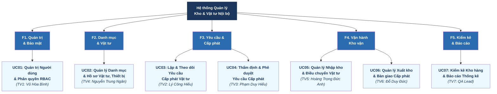
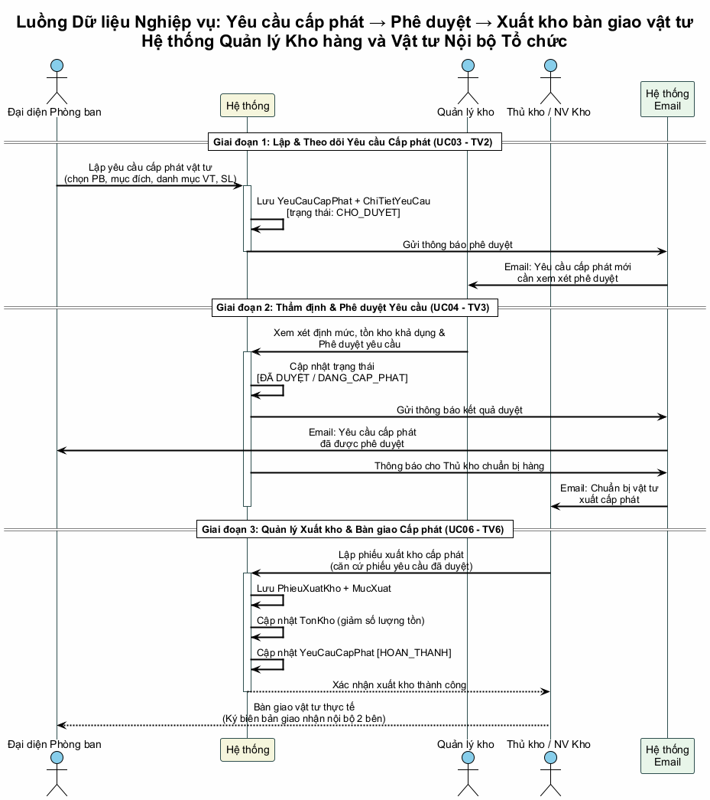
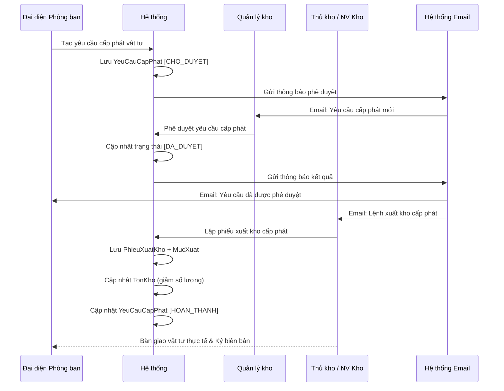
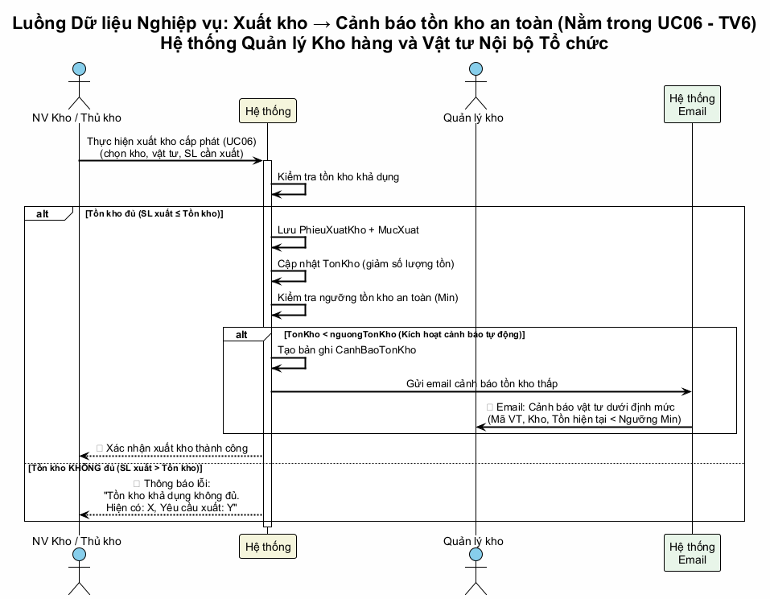
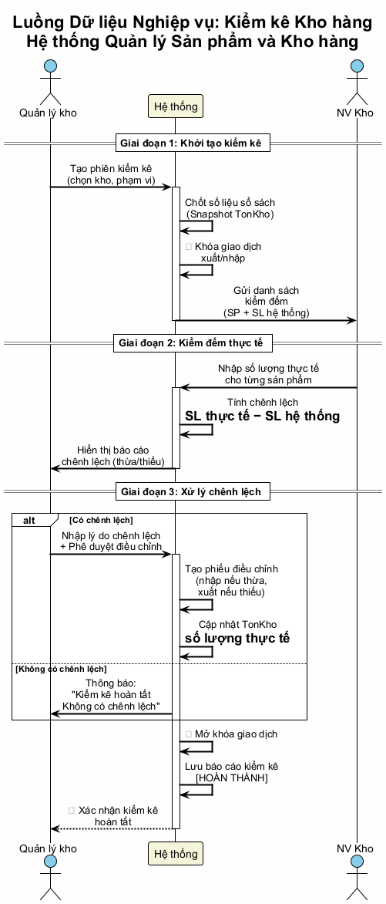
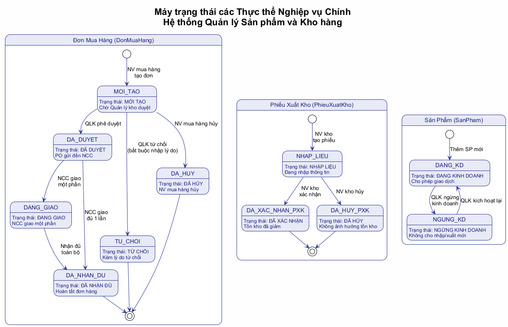

# Mô hình Chức năng Chi tiết — Hệ thống Quản lý Kho hàng và Vật tư Nội bộ Tổ chức

> **Học phần**: IT3120 – Phân tích và Thiết kế Hệ thống Thông tin  
> **Đại học Bách Khoa Hà Nội (HUST)** — Nhóm G8  
> **Phương pháp**: Phân tích chức năng theo tiến trình EUP, sử dụng UML 2.5  
> **Đặc tả phạm vi**: Quản lý tài sản, vật tư, trang thiết bị và kho lưu trữ nội bộ của một tổ chức — **Hoàn toàn không có nghiệp vụ mua bán thương mại**.

---

## 1. Tổng quan Mô hình Chức năng

Mô hình chức năng (Functional Model) là thành phần cốt lõi trong giai đoạn **Phân tích hệ thống**, đặc tả **hệ thống làm gì** (what) chứ không phải **làm như thế nào** (how). Mô hình bao gồm:

| Thành phần | Mục đích | Tài liệu tham chiếu |
|:--|:--|:--|
| Biểu đồ phân rã chức năng (BFD) | Phân rã hệ thống thành các nhóm chức năng con | Mục 2 |
| Biểu đồ Ca sử dụng (Use Case Diagram) | Xác định tác nhân và các ca sử dụng | [02-use-case-diagram.md](./02-use-case-diagram.md) |
| Đặc tả Ca sử dụng (Use Case Specs) | Mô tả chi tiết luồng sự kiện | [03-use-case-specs.md](./03-use-case-specs.md) |
| Biểu đồ Hoạt động (Activity Diagrams) | Mô hình hóa luồng công việc nghiệp vụ | [04-activity-diagrams.md](./04-activity-diagrams.md) |
| Ma trận CRUD | Ánh xạ chức năng ↔ thực thể dữ liệu | Mục 5 |
| Luồng dữ liệu nghiệp vụ | Mô tả luồng dữ liệu giữa các chức năng | Mục 6 |

---

## 2. Biểu đồ Phân rã Chức năng (Business Function Decomposition – BFD)

Phân rã hệ thống từ mức tổng quát xuống **07 Ca sử dụng nghiệp vụ cốt lõi** tương ứng với 07 thành viên trong nhóm dự án (không tính Đăng nhập/Đăng xuất theo quy định của Giảng viên):

File mã nguồn PlantUML: [functional-model-bfd.puml](../plantuml/functional-model-bfd.puml)

Xem mã Mermaid (Cấu trúc 7 Ca sử dụng cốt lõi)

---

## 3. Đặc tả Chi tiết Từng Nhóm Chức năng

### 3.1 F1 — Quản lý Xác thực & Phân quyền

#### F1.1 Đăng nhập / Đăng xuất (UC01)

| Thuộc tính | Nội dung |
|:--|:--|
| **Mô tả** | Người dùng xác thực danh tính để truy cập hệ thống; đăng xuất để kết thúc phiên làm việc |
| **Tác nhân** | Tất cả (Admin, Quản lý kho, Đại diện phòng ban, Thủ kho / NV kho) |
| **Độ phức tạp** | Simple (1–3 transactions) |
| **Dữ liệu đầu vào** | Tên đăng nhập, mật khẩu |
| **Dữ liệu đầu ra** | Phiên đăng nhập (session token), thông tin vai trò người dùng |
| **Quy tắc nghiệp vụ** | BR01: Mật khẩu phải được mã hóa hash (bcrypt); BR02: Khóa tài khoản sau 5 lần đăng nhập sai liên tiếp; BR03: Session timeout sau 30 phút không hoạt động |

**Các chức năng nguyên thủy:**

| ID | Chức năng | Mô tả chi tiết |
|:--|:--|:--|
| F1.1.1 | Xác thực thông tin đăng nhập | Nhận tên đăng nhập + mật khẩu, so khớp hash trong CSDL, trả về kết quả |
| F1.1.2 | Tạo phiên đăng nhập | Sinh session token, lưu thông tin phiên (IP, thời gian, vai trò) |
| F1.1.3 | Ghi log đăng nhập | Ghi nhật ký đăng nhập thành công/thất bại vào bảng AuditLog |
| F1.1.4 | Hủy phiên đăng xuất | Xóa session token, chuyển hướng về trang đăng nhập |

#### F1.2 Phân quyền người dùng (UC02)

| Thuộc tính | Nội dung |
|:--|:--|
| **Mô tả** | Quản trị viên quản lý danh mục vai trò, gán và thu hồi vai trò cho tài khoản nhân viên, cấu hình quyền hạn truy cập chức năng và dữ liệu theo cơ chế RBAC |
| **Tác nhân** | Quản trị viên (Admin) |
| **Độ phức tạp** | Average (5 transactions) |
| **Dữ liệu đầu vào** | ID tài khoản, mã vai trò (`ROLE_ADMIN`, `ROLE_WAREHOUSE_MGR`, `ROLE_DEPT_STAFF`, `ROLE_WAREHOUSE_STAFF`), danh sách quyền hạn (Permissions) |
| **Dữ liệu đầu ra** | Ma trận phân quyền được cập nhật, bảng ghi log phân quyền |
| **Quy tắc nghiệp vụ** | BR01: Xác thực tài khoản; BR02: Phân quyền nguyên tắc đặc quyền tối thiểu; BR40: Mật khẩu mặc định và đổi lần đầu |

| ID | Chức năng | Mô tả chi tiết | Quy tắc nghiệp vụ |
|:--|:--|:--|:--|
| F1.2.1 | Xem danh sách vai trò | Hiển thị các vai trò hệ thống và số lượng người dùng được gán | — |
| F1.2.2 | Cấu hình quyền hạn vai trò | Gán/hủy các quyền chức năng (Read, Write, Delete, Approve, Export) cho vai trò | — |
| F1.2.3 | Gán vai trò cho tài khoản | Liên kết tài khoản nhân viên với một hoặc nhiều vai trò tương ứng | — |
| F1.2.4 | Thu hồi vai trò | Gỡ bỏ vai trò khỏi tài khoản khi nhân viên chuyển công tác hoặc nghỉ việc | BR41: Không xóa vật lý |
| F1.2.5 | Ghi nhật ký phân quyền | Lưu lịch sử thay đổi quyền của tài khoản phục vụ kiểm toán | BR08: Audit Log |

---

### 3.2 F2 — Quản lý Vật tư, Thiết bị

#### F2.1 Quản lý vật tư (UC03)

| ID | Chức năng | Mô tả chi tiết | Quy tắc nghiệp vụ |
|:--|:--|:--|:--|
| F2.1.1 | Thêm vật tư mới | Nhập mã VT, tên, ĐVT, quy cách kỹ thuật, ngưỡng tồn an toàn | BR04: Mã VT duy nhất; BR06: Ngưỡng tồn ≥ 0 |
| F2.1.2 | Cập nhật vật tư | Sửa quy cách, đơn vị tính, ngưỡng cảnh báo | BR07: Không sửa mã VT; BR08: Ghi log lịch sử |
| F2.1.3 | Ngừng sử dụng vật tư | Chuyển trạng thái sang `NGUNG_SU_DUNG` | BR09: Không xóa vật lý khi đã có giao dịch kho |
| F2.1.4 | Xem chi tiết vật tư | Hiển thị thông số, vị trí lưu kho và tồn kho theo từng kho | — |
| F2.1.5 | Liệt kê vật tư | Hiển thị danh sách có phân trang, lọc theo trạng thái | — |

#### F2.2 Quản lý danh mục vật tư (UC04)

| ID | Chức năng | Mô tả chi tiết | Quy tắc nghiệp vụ |
|:--|:--|:--|:--|
| F2.2.1 | Thêm danh mục | Tạo danh mục phân cấp (cha - con) | BR10: Tên danh mục duy nhất trong cùng cấp cha |
| F2.2.2 | Sửa danh mục | Cập nhật tên, mô tả danh mục | BR11: Không tạo vòng lặp cây danh mục |
| F2.2.3 | Xóa danh mục | Xóa danh mục rỗng (không chứa vật tư hoặc danh mục con) | BR12: Không xóa danh mục đang có vật tư |
| F2.2.4 | Xem cây danh mục | Hiển thị sơ đồ cấu trúc phân cấp danh mục | — |

#### F2.3 Tìm kiếm & tra cứu vật tư (UC05)

| Thuộc tính | Nội dung |
|:--|:--|
| **Mô tả** | Cung cấp công cụ tra cứu thông tin vật tư đa tiêu chí cho mọi người dùng trong cơ quan |
| **Tác nhân** | Tất cả người dùng (Admin, Quản lý kho, Thủ kho, Đại diện phòng ban) |
| **Độ phức tạp** | Simple (2 transactions) |
| **Dữ liệu đầu vào** | Từ khóa (mã/tên vật tư), mã danh mục, trạng thái lưu hành, khoảng tồn kho |
| **Dữ liệu đầu ra** | Danh sách kết quả phù hợp kèm số lượng tồn khả dụng và vị trí lưu kho |

| ID | Chức năng | Mô tả chi tiết | Quy tắc nghiệp vụ |
|:--|:--|:--|:--|
| F2.3.1 | Tìm kiếm theo từ khóa | Tìm kiếm nhanh theo mã vật tư, tên hoặc thông số kỹ thuật | — |
| F2.3.2 | Lọc theo danh mục | Lọc vật tư theo cây phân cấp nhóm/chủng loại danh mục | — |
| F2.3.3 | Lọc theo trạng thái | Lọc theo trạng thái `DANG_SU_DUNG` hoặc `NGUNG_SU_DUNG` | — |
| F2.3.4 | Lọc theo mức tồn kho | Lọc nhanh các vật tư: Còn tồn, Hết tồn, Tồn dưới ngưỡng an toàn | — |
| F2.3.5 | Sắp xếp & Kết xuất | Sắp xếp theo tên, mã, số lượng tồn; hỗ trợ in danh sách tra cứu | — |

---

### 3.3 F3 — Vận hành Kho hàng

#### F3.1 Tạo phiếu nhập kho nội bộ (UC06)

| ID | Chức năng | Mô tả chi tiết | Quy tắc nghiệp vụ |
|:--|:--|:--|:--|
| F3.1.1 | Khởi tạo phiếu nhập | Tự sinh mã (`PNK-YYYYMMDD-XXX`), gán thời điểm, thủ kho lập | BR13: Mã phiếu nhập duy nhất |
| F3.1.2 | Chọn kho nhận hàng | Chọn kho tiếp nhận vật tư từ danh mục kho quản lý | — |
| F3.1.3 | Chọn lý do nhập | Phân bổ cấp trên, hoàn nhập phòng ban, điều chuyển đến, kiểm kê thừa | — |
| F3.1.4 | Chọn nguồn bàn giao | Chọn phòng ban bàn giao hoặc cơ quan phân bổ | BR14: Ghi rõ nguồn bàn giao |
| F3.1.5 | Thêm mục nhập kho | Chọn vật tư, nhập số lượng thực nhận, chỉ định ô/kệ lưu kho | BR15: Số lượng nhập > 0; BR16: Vật tư DANG_SU_DUNG |
| F3.1.6 | Xác nhận lưu phiếu | Lưu phiếu nhập trạng thái `DA_XAC_NHAN` | BR19: Ký nhận biên bản |
| F3.1.7 | Cập nhật tồn kho | Tăng số lượng tồn kho nguyên tử (`TonKho += soLuong`) | BR18: Cập nhật tồn kho nguyên tử (transaction) |
| F3.1.8 | Hủy phiếu nhập | Hủy bỏ trước khi xác nhận lưu | — |

#### F3.2 Tạo phiếu xuất kho nội bộ (UC07)

| ID | Chức năng | Mô tả chi tiết | Quy tắc nghiệp vụ |
|:--|:--|:--|:--|
| F3.2.1 | Khởi tạo phiếu xuất | Tự sinh mã (`PXK-YYYYMMDD-XXX`), gán ngày giờ, thủ kho | BR20: Mã phiếu xuất duy nhất |
| F3.2.2 | Chọn kho xuất | Chọn cơ sở kho thực hiện xuất vật tư | — |
| F3.2.3 | Chọn lý do xuất | Cấp phát phòng ban, chuyển kho đi, thanh lý hủy, kiểm kê thiếu | — |
| F3.2.4 | Chọn phòng ban nhận | Chọn phòng ban hoặc căn cứ phiếu yêu cầu cấp phát đã duyệt | — |
| F3.2.5 | Thêm mục xuất kho | Chọn vật tư, nhập số lượng cần xuất | BR21: Số lượng xuất ≤ tồn khả dụng (chống xuất âm) |
| F3.2.6 | Kiểm tra vật tư khóa | Kiểm tra vật tư có thuộc đợt kiểm kê đang diễn ra không | BR23: Không xuất vật tư đang bị khóa kiểm kê |
| F3.2.7 | Cập nhật tồn kho | Trừ tồn kho nguyên tử (`TonKho -= soLuong`) | BR24: Trừ tồn kho transaction an toàn |
| F3.2.8 | Kiểm tra cảnh báo | Tự động so sánh với ngưỡng an toàn để kích hoạt UC11 | — |

#### F3.3 Chuyển kho nội bộ (UC08)

| Thuộc tính | Nội dung |
|:--|:--|
| **Mô tả** | Điều chuyển vật tư, thiết bị giữa các kho nội bộ trực thuộc cơ quan/tổ chức (kho trung tâm sang kho phân xưởng/chi nhánh) |
| **Tác nhân** | Quản lý kho (khởi tạo/phê duyệt), Nhân viên kho (thực hiện xuất và nhập) |
| **Độ phức tạp** | Average (6 transactions) |
| **Dữ liệu đầu vào** | Kho nguồn, kho đích, danh sách vật tư cần chuyển, số lượng, lý do điều chuyển |
| **Dữ liệu đầu ra** | Phiếu chuyển kho (`PCK-YYYYMMDD-XXX`), tự động sinh phiếu xuất tại kho nguồn và phiếu nhập tại kho đích |
| **Quy tắc nghiệp vụ** | BR21: Kiểm tra tồn kho nguồn; BR25: Tự động đồng bộ phiếu xuất nguồn và nhập đích; BR18, BR24: Giao dịch cập nhật tồn kho 2 đầu an toàn |

| ID | Chức năng | Mô tả chi tiết | Quy tắc nghiệp vụ |
|:--|:--|:--|:--|
| F3.3.1 | Khởi tạo lệnh chuyển kho | Chọn kho xuất (nguồn) và kho nhập (đích) khác nhau | Kho nguồn ≠ Kho đích |
| F3.3.2 | Thêm danh sách vật tư chuyển | Chọn vật tư và số lượng cần điều chuyển | Số lượng ≤ tồn kho nguồn |
| F3.3.3 | Xác nhận xuất kho nguồn | Tự động tạo phiếu xuất kho điều chuyển, trừ tồn kho nguồn | BR24, BR25 |
| F3.3.4 | Xác nhận nhập kho đích | Tự động tạo phiếu nhập kho tiếp nhận, tăng tồn kho đích | BR18, BR25 |
| F3.3.5 | In phiếu điều chuyển | In biên bản bàn giao vận chuyển nội bộ | — |

#### F3.4 Kiểm kê kho hàng & Cân đối (UC09)

| Thuộc tính | Nội dung |
|:--|:--|
| **Mô tả** | Tổ chức kỳ kiểm kê hiện vật định kỳ hoặc đột xuất, đối chiếu số liệu sổ sách với thực tế kiểm đếm, ghi nhận giải trình và tự động sinh phiếu điều chỉnh cân bằng |
| **Tác nhân** | Quản lý kho (khởi tạo, phê duyệt), Nhân viên kho (kiểm đếm thực tế) |
| **Độ phức tạp** | Complex (11 transactions) |
| **Dữ liệu đầu vào** | Kho kiểm kê, phạm vi (toàn kho hoặc theo nhóm vật tư), số lượng đếm thực tế, lý do chênh lệch |
| **Dữ liệu đầu ra** | Phiếu kiểm kê (`PKK-YYYYMMDD-XXX`), bảng đối chiếu sai lệch, các phiếu điều chỉnh tồn kho tự sinh |
| **Quy tắc nghiệp vụ** | BR26: Tối đa 1 phiên kiểm kê mở/kho; BR27: Khóa giao dịch xuất/nhập; BR28: Bắt buộc giải trình chênh lệch; BR29: Cập nhật tồn kho thực tế sau khi duyệt |

| ID | Chức năng | Mô tả chi tiết | Quy tắc nghiệp vụ |
|:--|:--|:--|:--|
| F3.4.1 | Tạo phiên kiểm kê | Chọn kho kiểm kê, thời điểm bắt đầu, hội đồng kiểm kê | BR26: 1 phiên kiểm kê/kho |
| F3.4.2 | Chốt tồn sổ sách | Chụp ảnh dữ liệu tồn kho hiện tại (Stock Snapshot), tạm khóa giao dịch xuất/nhập | BR27: Khóa giao dịch kho |
| F3.4.3 | Sinh danh sách kiểm đếm | Xuất bảng kê biểu mẫu đếm thực tế cho nhân viên kho | — |
| F3.4.4 | Nhập số lượng thực tế | Thủ kho nhập số liệu đếm được tại từng ô/kệ lưu trữ | Số lượng thực đếm ≥ 0 |
| F3.4.5 | Tính toán đối soát chênh lệch | Tự động tính: `ChenhLech = SL_ThucTe - SL_SoSach` (Thừa/Thiếu/Khớp) | — |
| F3.4.6 | Nhập giải trình nguyên nhân | Bắt buộc nhập biên bản giải trình cho các mục có chênh lệch | BR28: Bắt buộc giải trình |
| F3.4.7 | Phê duyệt cân bằng tồn kho | Quản lý kho duyệt, tự sinh phiếu nhập điều chỉnh (thừa) hoặc phiếu xuất điều chỉnh (thiếu) | BR29: Cân đối nguyên tử |
| F3.4.8 | Mở khóa giao dịch & Lưu hồ sơ | Mở khóa xuất/nhập, lưu biên bản kiểm kê hoàn tất vào kho lưu trữ | — |

#### F3.5 Tra cứu tồn kho tức thời & Vị trí lưu (UC10)

| Thuộc tính | Nội dung |
|:--|:--|
| **Mô tả** | Cung cấp góc nhìn thời gian thực về tình trạng tồn kho vật lý, số lượng khả dụng, số lượng đang chờ xuất, và vị trí ô/kệ lưu trữ chính xác |
| **Tác nhân** | Quản lý kho, Nhân viên kho, Lãnh đạo |
| **Độ phức tạp** | Average (4 transactions) |
| **Dữ liệu đầu vào** | Mã kho, mã vật tư, nhóm danh mục, tình trạng tồn |
| **Dữ liệu đầu ra** | Bảng hiển thị: Số lượng tồn tổng, Đang chờ xuất, Tồn khả dụng, Vị trí ô/kệ/tầng |

| ID | Chức năng | Mô tả chi tiết | Quy tắc nghiệp vụ |
|:--|:--|:--|:--|
| F3.5.1 | Xem tồn kho theo kho | Hiển thị danh sách tồn kho chi tiết tại từng kho cụ thể | — |
| F3.5.2 | Tra cứu vị trí lưu kho | Hiển thị tọa độ chính xác: Dãy Kệ - Tầng - Ô chứa của từng vật tư | — |
| F3.5.3 | Tính toán tồn khả dụng | Tính `TonKhaDung = TonKhoThucTe - SoLuongChoXuat` | Chống xuất trùng lặp |
| F3.5.4 | Xem thẻ kho (Stock Card) | Hiển thị toàn bộ lịch sử xuất/nhập/tồn theo thời gian của một vật tư | Ghi nhận đầy đủ chứng từ |

#### F3.6 Cảnh báo tồn kho dưới ngưỡng an toàn (UC11)

| Thuộc tính | Nội dung |
|:--|:--|
| **Mô tả** | Chức năng giám sát tự động kích hoạt khi có giao dịch xuất kho hoặc định kỳ rà soát, phát hiện vật tư chạm hoặc giảm dưới ngưỡng an toàn tối thiểu và phát cảnh báo |
| **Tác nhân** | Hệ thống (Sự kiện trạng thái / Hệ thống Email) |
| **Độ phức tạp** | Simple (2 transactions) |
| **Dữ liệu đầu vào** | Số lượng tồn kho hiện tại, ngưỡng tồn an toàn (`NguongToiThieu`) |
| **Dữ liệu đầu ra** | Cảnh báo đỏ trên Dashboard, email thông báo tự động đến Quản lý kho |
| **Quy tắc nghiệp vụ** | BR06: Ngưỡng an toàn ≥ 0; Tự động kích hoạt thông qua quan hệ `<<extend>>` từ UC07 / UC10 |

| ID | Chức năng | Mô tả chi tiết | Quy tắc nghiệp vụ |
|:--|:--|:--|:--|
| F3.6.1 | Quét & So sánh ngưỡng tồn | So sánh tự động `TonKho.soLuong <= VatTu.nguongTonKho` sau mỗi giao dịch xuất kho | Kích hoạt tự động |
| F3.6.2 | Đánh dấu cảnh báo trên UI | Đánh dấu đỏ/vàng trên Dashboard quản trị và danh sách vật tư | — |
| F3.6.3 | Gửi email thông báo tự động | Kích hoạt dịch vụ SMTP gửi email tóm tắt vật tư thiếu hụt cho Quản lý kho | Email Service |
| F3.6.4 | Lập danh sách đề xuất tiếp nhận | Tự động tổng hợp danh sách vật tư cần bổ sung vào báo cáo tiếp nhận | Phục vụ lập kế hoạch |

---

### 3.4 F4 — Quản lý Yêu cầu & Cấp phát Nội bộ

#### F4.1 Quản lý phòng ban / đơn vị (UC12)

| ID | Chức năng | Mô tả chi tiết | Quy tắc nghiệp vụ |
|:--|:--|:--|:--|
| F4.1.1 | Thêm phòng ban mới | Nhập mã PB, tên, địa điểm, số điện thoại, người phụ trách | BR30: Mã phòng ban duy nhất |
| F4.1.2 | Cập nhật thông tin PB | Sửa thông tin liên hệ, địa điểm phòng ban | — |
| F4.1.3 | Vô hiệu hóa phòng ban | Chuyển trạng thái `NGUNG_HOAT_DONG` | BR31: Không xóa vật lý PB đã có phát sinh yêu cầu |
| F4.1.4 | Xem chi tiết PB | Hiển thị thông tin phòng ban kèm lịch sử các lần lĩnh vật tư | — |
| F4.1.5 | Cấu hình định mức PB | Thiết lập hạn mức vật tư tối đa phòng ban được lĩnh theo kỳ | — |

#### F4.2 Tạo yêu cầu cấp phát vật tư (UC13)

| Thuộc tính | Nội dung |
|:--|:--|
| **Mô tả** | Đại diện phòng ban lập phiếu đề xuất cấp phát vật tư, trang thiết bị phục vụ công tác |
| **Tác nhân** | Đại diện Phòng ban |
| **Độ phức tạp** | Complex (9 transactions) |
| **Tiền điều kiện** | Đại diện phòng ban đã đăng nhập; tài khoản gắn với phòng ban hợp lệ |
| **Hậu điều kiện** | Phiếu yêu cầu lưu trạng thái `CHO_DUYET`; thông báo gửi đến Quản lý kho |

| ID | Chức năng | Mô tả chi tiết | Quy tắc nghiệp vụ |
|:--|:--|:--|:--|
| F4.2.1 | Khởi tạo yêu cầu | Tự sinh mã (`YC-YYYYMMDD-XXX`), gán thời điểm, người tạo | BR32: Mã yêu cầu duy nhất |
| F4.2.2 | Nhập mục đích sử dụng | Nêu rõ nhu cầu (trang bị mới, sửa chữa, định kỳ) | BR33: Mục đích không được để trống |
| F4.2.3 | Thêm mục vật tư | Chọn vật tư, nhập số lượng đề nghị | BR34: Số lượng yêu cầu > 0 |
| F4.2.4 | Kiểm tra định mức | So sánh số lượng yêu cầu với định mức còn lại của phòng ban | BR35: Cảnh báo nếu vượt định mức |
| F4.2.5 | Xác nhận gửi yêu cầu | Lưu YeuCauCapPhat + ChiTietYeuCau, trạng thái `CHO_DUYET` | BR36: Ngày tiếp nhận hợp lệ |
| F4.2.6 | Gửi thông báo phê duyệt | Gửi email và thông báo Dashboard cho Quản lý kho | — |

#### F4.3 Duyệt yêu cầu cấp phát (UC14)

| ID | Chức năng | Mô tả chi tiết | Quy tắc nghiệp vụ |
|:--|:--|:--|:--|
| F4.3.1 | Xem DS yêu cầu chờ duyệt | Liệt kê các phiếu `CHO_DUYET`, sắp xếp theo thời gian | — |
| F4.3.2 | Thẩm định yêu cầu | Xem chi tiết, so sánh với tồn kho khả dụng hiện tại | — |
| F4.3.3 | Phê duyệt yêu cầu | Xác nhận số lượng cấp phát, chuyển trạng thái `DA_DUYET` | Phê duyệt đủ hoặc một phần |
| F4.3.4 | Từ chối yêu cầu | Chuyển trạng thái `TU_CHOI`, bắt buộc nhập lý do | BR37: Lý do từ chối không được để trống |
| F4.3.5 | Gửi thông báo kết quả | Email thông báo kết quả cho phòng ban và lệnh xuất cho thủ kho | — |

#### F4.4 Bàn giao & tiếp nhận vật tư (UC15)

| Thuộc tính | Nội dung |
|:--|:--|
| **Mô tả** | Nhân viên kho và Đại diện phòng ban thực hiện bàn giao hiện vật thực tế dựa trên yêu cầu cấp phát đã duyệt, ký biên bản bàn giao và cập nhật trừ kho |
| **Tác nhân** | Nhân viên kho (thực hiện bàn giao, lập phiếu xuất), Đại diện phòng ban (tiếp nhận, ký biên bản) |
| **Độ phức tạp** | Complex (8 transactions) |
| **Dữ liệu đầu vào** | Mã yêu cầu cấp phát đã duyệt (`DA_DUYET`), số lượng thực giao, chữ ký/xác nhận tiếp nhận |
| **Dữ liệu đầu ra** | Phiếu xuất kho cấp phát (`PXK-YYYYMMDD-XXX`), biên bản bàn giao đã ký, trạng thái yêu cầu chuyển `HOAN_THANH` |
| **Quy tắc nghiệp vụ** | BR38: Số lượng bàn giao ≤ số lượng đã duyệt; BR21: Kiểm tra tồn kho khả dụng; BR24: Trừ tồn kho an toàn |

| ID | Chức năng | Mô tả chi tiết | Quy tắc nghiệp vụ |
|:--|:--|:--|:--|
| F4.4.1 | Tra cứu yêu cầu đã duyệt | Chọn phiếu yêu cầu ở trạng thái `DA_DUYET` cần xuất giao | — |
| F4.4.2 | Lập phiếu xuất bàn giao | Hệ thống kế thừa thông tin yêu cầu, tự tạo phiếu xuất kho cấp phát | Include UC07 |
| F4.4.3 | Xác nhận số lượng bàn giao | Đối soát số lượng thực tế giao nhận với số lượng duyệt | BR38: Số giao ≤ số duyệt |
| F4.4.4 | Cập nhật trừ tồn kho | Trừ số lượng tồn kho nguyên tử tại kho xuất | BR24: Trừ tồn kho |
| F4.4.5 | Ký biên bản bàn giao | Ghi nhận xác nhận 2 bên (Thủ kho giao, Cán bộ phòng ban nhận) | Ký biên bản pháp lý |
| F4.4.6 | Đóng yêu cầu cấp phát | Chuyển trạng thái yêu cầu cấp phát sang `HOAN_THANH` | Kết thúc quy trình |

---

### 3.5 F5 — Quản lý Nhân sự

#### F5.1 Quản lý nhân viên (UC16)

| Thuộc tính | Nội dung |
|:--|:--|
| **Mô tả** | Quản lý thông tin hồ sơ nhân viên trong tổ chức, phân bổ nhân viên vào phòng ban/kho hàng và tạo tài khoản đăng nhập tương ứng |
| **Tác nhân** | Quản trị viên (Admin) |
| **Độ phức tạp** | Average (5 transactions) |
| **Dữ liệu đầu vào** | Mã nhân viên, họ tên, ngày sinh, CCCD, email, số điện thoại, phòng ban trực thuộc, chức vụ |
| **Dữ liệu đầu ra** | Hồ sơ nhân viên được lưu trữ, tài khoản liên kết được khởi tạo |
| **Quy tắc nghiệp vụ** | BR39: Số CCCD và email duy nhất; BR40: Mật khẩu mặc định đổi lần đầu; BR41: Không xóa vật lý nhân viên |

| ID | Chức năng | Mô tả chi tiết | Quy tắc nghiệp vụ |
|:--|:--|:--|:--|
| F5.1.1 | Thêm nhân viên mới | Nhập thông tin nhân sự, gắn với phòng ban cụ thể | BR39: CCCD, email duy nhất |
| F5.1.2 | Cập nhật hồ sơ | Chỉnh sửa thông tin liên hệ, phòng ban, chức vụ | — |
| F5.1.3 | Cấp tài khoản hệ thống | Tự động tạo tài khoản đăng nhập cho nhân viên mới | BR40: Mật khẩu mặc định |
| F5.1.4 | Chuyển trạng thái nghỉ việc | Vô hiệu hóa tài khoản, chuyển trạng thái `DA_NGHI_VIEC` | BR41: Không xóa vật lý |
| F5.1.5 | Tra cứu nhân sự | Tìm kiếm nhân viên theo tên, phòng ban, vai trò | — |

---

### 3.6 F6 — Báo cáo & Thống kê

#### F6.1 Báo cáo tồn kho (UC17)

| Thuộc tính | Nội dung |
|:--|:--|
| **Mô tả** | Tổng hợp số liệu tồn kho toàn tổ chức, phân tích cơ cấu vật tư, cảnh báo hàng tồn dưới mức an toàn và tồn kho lâu ngày không biến động |
| **Tác nhân** | Quản lý kho, Quản trị viên, Lãnh đạo |
| **Độ phức tạp** | Average (6 transactions) |
| **Dữ liệu đầu vào** | Kỳ báo cáo (tháng/quý/năm), kho hàng cụ thể, nhóm danh mục vật tư |
| **Dữ liệu đầu ra** | Bảng báo cáo tồn kho tổng hợp, biểu đồ cơ cấu vật tư, danh sách cảnh báo thiếu hụt, file xuất Excel/PDF |

| ID | Chức năng | Mô tả chi tiết | Quy tắc nghiệp vụ |
|:--|:--|:--|:--|
| F6.1.1 | Báo cáo tồn tổng hợp | Tổng hợp số lượng tồn của tất cả vật tư trên toàn bộ các kho | — |
| F6.1.2 | Báo cáo tồn theo kho | Xem chi tiết số lượng và vị trí kệ của từng vật tư tại 1 kho cụ thể | — |
| F6.1.3 | Báo cáo dưới định mức | Liệt kê toàn bộ các vật tư có `TonKho <= NguongToiThieu` | Liên thông UC11 |
| F6.1.4 | Báo cáo tồn đọng chậm luân chuyển | Thống kê các vật tư không phát sinh giao dịch xuất/nhập trên 180 ngày | Hỗ trợ thanh lý |
| F6.1.5 | Kết xuất báo cáo | Xuất dữ liệu báo cáo ra định dạng file Excel (.xlsx) và in ấn (.pdf) | — |

#### F6.2 Báo cáo Xuất - Nhập - Tồn & Cấp phát Phòng ban (UC18)

| Thuộc tính | Nội dung |
|:--|:--|
| **Mô tả** | Thống kê toàn diện biến động kho (Tồn đầu kỳ, Tổng nhập, Tổng xuất, Tồn cuối kỳ) và tổng hợp số lượng vật tư, trang thiết bị đã cấp phát cho từng phòng ban theo kỳ |
| **Tác nhân** | Quản lý kho, Quản trị viên, Lãnh đạo |
| **Độ phức tạp** | Average (5 transactions) |
| **Dữ liệu đầu vào** | Từ ngày - đến ngày, mã phòng ban, mã kho hàng, danh mục vật tư |
| **Dữ liệu đầu ra** | Báo cáo bảng cân đối Xuất - Nhập - Tồn, bảng tổng hợp tình hình cấp phát theo đơn vị, tỷ lệ đáp ứng yêu cầu |

| ID | Chức năng | Mô tả chi tiết | Quy tắc nghiệp vụ |
|:--|:--|:--|:--|
| F6.2.1 | Báo cáo Xuất - Nhập - Tồn | Tính công thức: `TonCuoi = TonDau + TongNhap - TongXuat` cho từng vật tư | Công thức cân đối kế toán |
| F6.2.2 | Thống kê cấp phát theo PB | Tổng hợp danh mục và số lượng vật tư đã cấp cho từng phòng ban | Phục vụ kiểm soát định mức |
| F6.2.3 | Báo cáo tỷ lệ đáp ứng | So sánh số lượng yêu cầu (UC13) với số lượng thực cấp (UC15) | Đánh giá hiệu quả kho vận |
| F6.2.4 | Báo cáo điều chuyển liên kho | Thống kê lưu lượng luân chuyển hàng hóa giữa các kho nội bộ | — |
| F6.2.5 | Kết xuất & Lưu trữ kỳ báo cáo | Đóng sổ kỳ báo cáo, xuất file Excel/PDF nộp Lãnh đạo phê duyệt | Chứng từ lưu trữ |

---

## 4. Biểu đồ Ca sử dụng Tổng quan & Ma trận RBAC

### Quan hệ giữa các Ca sử dụng

File mã nguồn PlantUML: [functional-model-uc-relations.puml](../plantuml/functional-model-uc-relations.puml)

### Ma trận Phân quyền theo Vai trò (RBAC)

File mã nguồn PlantUML: [functional-model-rbac-matrix.puml](../plantuml/functional-model-rbac-matrix.puml)

---

## 5. Ma trận CRUD (07 Ca sử dụng Cốt lõi ↔ 18 Thực thể Dữ liệu)

> **C** = Create, **R** = Read, **U** = Update, **D** = Delete (soft delete / vô hiệu hóa)

| Ca sử dụng Cốt lõi \ Thực thể | VatTu | DanhMuc | Kho | TonKho | PhieuNhap | MucNhap | PhieuXuat | MucXuat | YeuCau | ChiTietYC | PhongBan | PhienKiemKe | MucKiemKe | NhanVien | TaiKhoan | VaiTro | Quyen | AuditLog |
|:---|:---:|:---:|:---:|:---:|:---:|:---:|:---:|:---:|:---:|:---:|:---:|:---:|:---:|:---:|:---:|:---:|:---:|:---:|
| **UC01: QL Người dùng & RBAC** | | | | | | | | | | | R | | | C,R,U,D | C,R,U,D | C,R,U,D | C,R | C,R |
| **UC02: QL Danh mục & Vật tư** | C,R,U,D | C,R,U,D | R | R | | | | | | | | | | | | | | C,R |
| **UC03: Yêu cầu Cấp phát VT** | R | R | | | | | | | C,R,U | C,R,U | R | | | R | | | | C,R |
| **UC04: Duyệt Cấp phát VT** | R | | R | R | | | | | R,U | R | R | | | R | | | | C,R |
| **UC05: Nhập kho & Chuyển kho** | R | | R | C,R,U | C,R | C,R | C,R | C,R | | | R | | | R | | | | C,R |
| **UC06: Xuất kho & Bàn giao** | R | | R | R,U | | | C,R | C,R | R,U | R | R | | | R | | | | C,R |
| **UC07: Kiểm kê & Báo cáo** | R | R | R | R,U | C,R | C,R | C,R | C,R | R | R | R | C,R,U | C,R,U | R | | | | C,R |

---

## 6. Luồng Dữ liệu Nghiệp vụ (Data Flow Overview)

### 6.1 Luồng Yêu cầu Cấp phát → Phê duyệt → Bàn giao Xuất kho

File mã nguồn PlantUML: [functional-model-flow-mua-nhap.puml](../plantuml/functional-model-flow-mua-nhap.puml)

Xem mã Mermaid (tham khảo)

### 6.2 Luồng Xuất kho – Cảnh báo Tồn thấp

File mã nguồn PlantUML: [functional-model-flow-xuat-canh-bao.puml](../plantuml/functional-model-flow-xuat-canh-bao.puml)

### 6.3 Luồng Kiểm kê Kho hàng

File mã nguồn PlantUML: [functional-model-flow-kiem-ke.puml](../plantuml/functional-model-flow-kiem-ke.puml)

---

## 7. Máy trạng thái các Thực thể Nghiệp vụ Chính

File mã nguồn PlantUML: [functional-model-state-machines.puml](../plantuml/functional-model-state-machines.puml)

---

## 8. Tổng hợp 41 Quy tắc Nghiệp vụ (Business Rules)

| ID | Quy tắc | Áp dụng cho |
|:--|:--|:--|
| BR01 | Mật khẩu mã hóa hash với thuật toán bcrypt | TaiKhoan |
| BR02 | Khóa tài khoản tạm thời sau 5 lần đăng nhập sai liên tiếp | TaiKhoan |
| BR03 | Session timeout tự động sau 30 phút không hoạt động | Phiên đăng nhập |
| BR04 | Mã vật tư duy nhất trong toàn hệ thống tổ chức | VatTu |
| BR05 | Quy cách và thông số kỹ thuật không được để trống | VatTu |
| BR06 | Ngưỡng tồn an toàn phải là số nguyên ≥ 0 | VatTu |
| BR07 | Không được phép sửa mã vật tư sau khi đã tạo | VatTu |
| BR08 | Ghi nhật ký hệ thống (Audit Log) mọi thay đổi vật tư | VatTu |
| BR09 | Không xóa vật lý vật tư đã phát sinh giao dịch xuất/nhập | VatTu |
| BR10 | Tên danh mục duy nhất trong cùng cấp phân nhánh | DanhMuc |
| BR11 | Không tạo vòng lặp đệ quy trong cây danh mục | DanhMuc |
| BR12 | Không xóa danh mục đang chứa vật tư hoặc nhánh con | DanhMuc |
| BR13 | Mã phiếu nhập kho tự sinh duy nhất theo định dạng chuẩn | PhieuNhapKho |
| BR14 | Phải ghi nhận rõ nguồn bàn giao phân bổ hoặc thu hồi | PhieuNhapKho |
| BR15 | Số lượng nhập thực tế phải là số nguyên > 0 | MucNhap |
| BR16 | Vật tư nhập phải đang ở trạng thái DANG_SU_DUNG | MucNhap |
| BR17 | Chỉ định rõ vị trí ô/kệ lưu kho cho từng dòng nhập | MucNhap |
| BR18 | Cập nhật tăng số lượng tồn kho nguyên tử (transaction) | TonKho |
| BR19 | Bắt buộc thủ kho và người giao ký xác nhận biên bản | PhieuNhapKho |
| BR20 | Mã phiếu xuất kho tự sinh duy nhất | PhieuXuatKho |
| BR21 | Số lượng xuất kho phải ≤ số lượng tồn khả dụng (chống xuất âm) | MucXuat |
| BR22 | Từ chối lưu phiếu xuất nếu tồn kho không đủ số lượng | MucXuat |
| BR23 | Tuyệt đối không xuất vật tư đang bị tạm khóa kiểm kê | PhienKiemKe |
| BR24 | Cập nhật giảm tồn kho nguyên tử, an toàn đồng thời | TonKho |
| BR25 | Tự động đồng bộ phiếu xuất kho nguồn và phiếu nhập kho đích khi chuyển kho | PhieuXuatKho, PhieuNhapKho |
| BR26 | Tại một thời điểm, mỗi kho chỉ được có tối đa 1 phiên kiểm kê mở | PhienKiemKe |
| BR27 | Khóa giao dịch xuất/nhập đối với phạm vi vật tư đang kiểm kê | PhienKiemKe |
| BR28 | Bắt buộc nhập lý do giải trình khi phát hiện chênh lệch thừa/thiếu | MucKiemKe |
| BR29 | Cập nhật cân đối tồn kho theo số liệu thực tế nguyên tử sau khi duyệt | TonKho |
| BR30 | Mã phòng ban duy nhất trong toàn cơ quan | PhongBan |
| BR31 | Không xóa vật lý phòng ban đã có phát sinh yêu cầu cấp phát | PhongBan |
| BR32 | Mã yêu cầu cấp phát tự sinh duy nhất | YeuCauCapPhat |
| BR33 | Bắt buộc nêu rõ mục đích sử dụng khi đề xuất cấp phát | YeuCauCapPhat |
| BR34 | Số lượng vật tư yêu cầu cấp phát phải > 0 | ChiTietYeuCau |
| BR35 | Cảnh báo khi số lượng yêu cầu vượt quá định mức kỳ của phòng ban | ChiTietYeuCau |
| BR36 | Ngày đề nghị tiếp nhận phải lớn hơn hoặc bằng ngày tạo yêu cầu | YeuCauCapPhat |
| BR37 | Quản lý kho bắt buộc nhập lý do nếu từ chối yêu cầu cấp phát | YeuCauCapPhat |
| BR38 | Số lượng bàn giao thực tế không vượt quá số lượng đã phê duyệt | MucXuat |
| BR39 | Số CCCD và email nhân viên duy nhất | NhanVien |
| BR40 | Mật khẩu mặc định được mã hóa hash và yêu cầu đổi lần đầu | TaiKhoan |
| BR41 | Không xóa vật lý nhân viên, chỉ chuyển trạng thái nghỉ việc để giữ chứng từ | NhanVien |

---

## 9. Kiểm tra Cân bằng Mô hình (Functional Model Balancing)

| Tiêu chí kiểm tra | Kết quả | Chi tiết kiểm chứng |
|:---|:---:|:---|
| **BFD ↔ Use Case Diagram** | ✅ | 07 Ca sử dụng nghiệp vụ cốt lõi ánh xạ 1:1 giữa BFD và Use Case Diagram |
| **Thành viên ↔ Ca sử dụng** | ✅ | Đúng 07 thành viên $\longleftrightarrow$ Đúng 07 Ca sử dụng lớn (mỗi TV làm Owner 1 UC trọn gói) |
| **UC Specs ↔ Activity Diagrams** | ✅ | Luồng sự kiện trong 7 UC specs khớp 100% với 7 Sơ đồ Hoạt động phân làn (Swimlanes) |
| **Chức năng ↔ Thực thể (CRUD)** | ✅ | Mọi thực thể CSDL (18 bảng) đều có đầy đủ C, R, U; không có thực thể mồ côi |
| **Tác nhân ↔ Ca sử dụng** | ✅ | 4 tác nhân người + 1 hệ thống ngoài tham gia đầy đủ; mỗi UC có đúng 1 Primary Actor |
| **FR ↔ UC** | ✅ | 15 yêu cầu chức năng (FR01–FR15) được bao phủ đầy đủ 100% bởi 7 Ca sử dụng |
| **Chức năng ↔ Quy tắc NV** | ✅ | 41 quy tắc nghiệp vụ (BR01–BR41) được tích hợp chặt chẽ vào các bước của 7 UC |
| **Sự kiện ↔ UC** | ✅ | 5 sự kiện nghiệp vụ kích hoạt chính xác các Ca sử dụng tương ứng |

---

## 10. Thống kê Tổng quan Mô hình 07 Ca Sử Dụng Cốt Lõi

| Chỉ số | Giá trị | Ghi chú |
|:---|:---:|:---|
| **Tổng số phân hệ nghiệp vụ (Level 1)** | **5** | Quản trị, Danh mục, Cấp phát, Kho vận, Kiểm kê & Báo cáo |
| **Tổng số ca sử dụng cốt lõi (Level 2)** | **7** | Đúng 7 UC theo giới hạn tối đa của Giảng viên (bỏ Đăng nhập/Đăng xuất) |
| **Tổng số thành viên nhóm thực hiện** | **7** | Tỷ lệ phân công 1:1 (Mỗi thành viên làm Owner trọn gói 1 UC) |
| **Tổng số chức năng thành phần (Level 3)**| **~45** | Các bước nghiệp vụ nguyên thủy cấu thành 7 ca sử dụng |
| **Tổng số quy tắc nghiệp vụ** | **41** | BR01 đến BR41 kiểm soát toàn vẹn dữ liệu |
| **Tổng số thực thể CSDL quản lý** | **18** | Chuẩn hóa 3NF không chứa giá tiền/mua bán |
| **Tổng số tác nhân tham gia** | **5** | 4 người dùng + 1 hệ thống ngoài (SMTP Gateway) |
| **Tổng UAW (Unadjusted Actor Weight)** | **13** | 4 Complex (3đ) + 1 Simple (1đ) |
| **Tổng UUCW (Unadjusted Use Case Weight)**| **95** | 2 Average (10đ) + 5 Complex (15đ) |
| **Điểm UCP đã hiệu chỉnh** | **82.76** | UUCP (108) $\times$ TCF (1.015) $\times$ EF (0.755) |
| **Tổng nỗ lực ước tính** | **1,655 giờ** | PF = 20 h/UCP (~236.4 giờ / thành viên trong 15 tuần) |

---

## 11. Bảng Tổng Hợp Chi Tiết 07 Ca Sử Dụng Cốt Lõi của Hệ Thống

| STT | Mã UC | Tên Ca Sử Dụng Cốt Lõi | Phân hệ BFD | Tác nhân chính | Tiền điều kiện | Hậu điều kiện | Số GD | Phân loại | UUCW | Thành viên phụ trách (Owner) |
|:---:|:---|:---|:---|:---|:---|:---|:---:|:---:|:---:|:---|
| **01** | **UC01** | Quản trị Người dùng & Phân quyền RBAC | F1. Quản trị & Bảo mật | Quản trị viên (Admin) | Đăng nhập quyền Admin | Tài khoản, vai trò và quyền hạn cập nhật CSDL; ghi Audit Log | 6 | Average | 10 | **Vũ Hòa Bình** *(TV1)* |
| **02** | **UC02** | Quản lý Danh mục & Hồ sơ Vật tư, Thiết bị | F2. Danh mục & Vật tư | Quản lý kho | Đăng nhập quyền Quản lý | Cây danh mục, thông số VT và ngưỡng an toàn được lưu trữ | 8 | Complex | 15 | **Nguyễn Trung Ngân** *(TV4)* |
| **03** | **UC03** | Lập & Theo dõi Yêu cầu Cấp phát Vật tư | F3. Yêu cầu & Cấp phát | Đại diện Phòng ban | Tài khoản thuộc phòng ban hợp lệ | Phiếu yêu cầu lưu `CHO_DUYET`; gửi email thông báo Quản lý | 9 | Complex | 15 | **Lý Công Hiếu** *(TV2)* |
| **04** | **UC04** | Thẩm định & Phê duyệt Yêu cầu Cấp phát | F3. Yêu cầu & Cấp phát | Quản lý kho | Có phiếu yêu cầu `CHO_DUYET` | Cập nhật `DA_DUYET`/`TU_CHOI`; phát lệnh xuất cho Thủ kho | 6 | Average | 10 | **Phạm Duy Hiếu** *(TV3)* |
| **05** | **UC05** | Quản lý Nhập kho & Điều chuyển Vật tư | F4. Vận hành Kho vận | Thủ kho / NV Kho | Có hàng thực tế & biên bản giao nhận | Phiếu nhập lưu `DA_XAC_NHAN`; tồn kho tăng nguyên tử (ACID) | 10 | Complex | 15 | **Hoàng Trọng Đức Anh** *(TV5)* |
| **06** | **UC06** | Quản lý Xuất kho & Bàn giao Cấp phát | F4. Vận hành Kho vận | Thủ kho / NV Kho | Có lệnh yêu cầu `DA_DUYET`; tồn đủ | Phiếu xuất lưu; trừ tồn kho; ký nhận bàn giao; báo tồn thấp | 10 | Complex | 15 | **Đỗ Duy Đức** *(TV6)* |
| **07** | **UC07** | Kiểm kê Kho hàng & Báo cáo Thống kê | F5. Kiểm kê & Báo cáo | Quản lý kho | Lập kế hoạch kiểm kê; chốt sổ | Tồn kho điều chỉnh theo thực tế; xuất báo cáo XNT và cấp phát | 12 | Complex | 15 | **Thành viên 7** *(TV7)* |

---

## 12. Ma Trận Ánh Xạ Yêu Cầu Chức Năng (15 FR ↔ 07 UC Cốt Lõi ↔ CSDL 3NF)

| Mã FR | Nội dung Yêu cầu Chức năng | Ca sử dụng giải quyết | Phân hệ BFD | Bảng CSDL lưu trữ chính | Mức ưu tiên |
|:---:|:---|:---:|:---:|:---|:---:|
| **FR01** | Quản lý thông tin vật tư, thiết bị (thêm, sửa, ngừng sử dụng, tra cứu) | UC02 | F2 | `vattu`, `vitrikho` | Cao |
| **FR02** | Quản lý danh mục vật tư phân cấp đa tầng (nhóm / loại) | UC02 | F2 | `danhmucvattu` | Cao |
| **FR03** | Quản lý danh mục phòng ban, đơn vị nội bộ trực thuộc cơ quan | UC03 | F3 | `phongban`, `dinhmuccapphat` | Cao |
| **FR04** | Lập và theo dõi tiến độ phiếu yêu cầu cấp phát vật tư phòng ban | UC03 | F3 | `yeucaucapphat`, `chitietyeucau` | Cao |
| **FR05** | Thẩm định, phê duyệt hoặc từ chối phiếu yêu cầu cấp phát vật tư | UC04 | F3 | `yeucaucapphat`, `lichsuduyet` | Cao |
| **FR06** | Tạo phiếu nhập kho nội bộ (tiếp nhận phân bổ, hoàn nhập, cân đối) | UC05 | F4 | `phieunhapkho`, `mucnhapkho`, `tonkho` | Cao |
| **FR07** | Tạo phiếu xuất kho nội bộ (cấp phát phòng ban, thanh lý, tiêu hủy) | UC06 | F4 | `phieuxuatkho`, `mucxuatkho`, `tonkho` | Cao |
| **FR08** | Giám sát tồn kho thời gian thực và tra cứu tọa độ ô/kệ lưu kho | UC06, UC02 | F4, F2 | `tonkho`, `vitrikho`, `khohang` | Cao |
| **FR09** | Tổ chức kiểm kê định kỳ, chốt số liệu sổ sách và xử lý cân đối | UC07 | F5 | `phienkiemke`, `muckiemke`, `tonkho` | Trung bình |
| **FR10** | Điều chuyển vật tư giữa các cơ sở kho nội bộ tổ chức | UC05 | F4 | `phieunhapkho`, `phieuxuatkho`, `tonkho` | Trung bình |
| **FR11** | Cảnh báo tự động khi số lượng tồn kho giảm chạm/dưới định mức an toàn | UC06 | F4 | `vattu`, `tonkho`, `thongbao` | Cao |
| **FR12** | Báo cáo tồn kho tổng hợp và chi tiết theo cơ sở kho lưu trữ | UC07 | F5 | `tonkho`, `vattu`, `khohang` | Cao |
| **FR13** | Báo cáo Xuất - Nhập - Tồn và thống kê cấp phát theo từng phòng ban | UC07 | F5 | `mucnhapkho`, `mucxuatkho`, `phongban` | Trung bình |
| **FR14** | Quản lý hồ sơ nhân viên cơ quan, điều phối đơn vị công tác | UC01 | F1 | `nhanvien`, `phongban` | Trung bình |
| **FR15** | Phân quyền người dùng theo vai trò (RBAC) và kiểm soát truy cập | UC01 | F1 | `taikhoan`, `vaitro`, `quyen`, `auditlog` | Cao |

